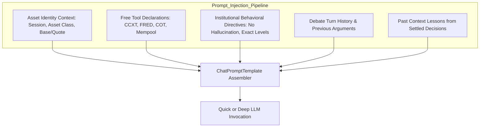

# TECHNICAL SPECIFICATION & COMPONENT CONTRACTS
## Institutional Trading Intelligence Platform (BTC, XAUUSD, USDJPY)
*Document Version: 1.0.0 | Status: Architecture Specification | Author: Lead AI Systems Architect & Quant Developer*

---

## 1. Domain Data Models & Pydantic Schemas

To ensure institutional rigor across the multi-asset intelligence pipeline, all structured outputs from agents and tools are governed by typed **Pydantic models**.

```
┌────────────────────────────────────────────────────────────────────────────────────────┐
│                              AGENT STRUCTURED SCHEMAS                                  │
├─────────────────────────┬──────────────────────────┬───────────────────────────────────┤
│ Macro Monetary Analyst  │ Bitcoin On-Chain Analyst │ Positioning Analyst (CFTC / Perp) │
│ - MacroMonetaryReport   │ - BitcoinOnChainReport   │ - InstitutionalPositioningReport  │
├─────────────────────────┼──────────────────────────┼───────────────────────────────────┤
│ Technical Analyst       │ Quant Trader Agent       │ Portfolio Fiduciary Manager       │
│ - TechStructureReport   │ - InstitutionalProposal  │ - InstitutionalDecision           │
└─────────────────────────┴──────────────────────────┴───────────────────────────────────┘
```

### 1.1 Technical Structure & Liquidity Schema (`TechStructureReport`)
Used by the **Technical & Liquidity Analyst** for market structure, order blocks, and ATR volatility:

```python
from enum import StrEnum
from pydantic import BaseModel, Field

class MarketRegime(StrEnum):
    STRONG_BULL_TREND = "Strong Bull Trend"
    MILD_BULL_TREND = "Mild Bull Trend"
    RANGING_COMPRESSION = "Ranging / Compression"
    MILD_BEAR_TREND = "Mild Bear Trend"
    STRONG_BEAR_TREND = "Strong Bear Trend"
    HIGH_VOLATILITY_EXPANSION = "High Volatility Expansion"

class KeyPriceLevel(BaseModel):
    level_type: str = Field(description="Support, Resistance, Liquidity Pool, or Fair Value Gap")
    price: float = Field(description="Exact price level in quote currency")
    significance: str = Field(description="High / Medium / Low institutional importance")
    touches_or_confluence: str = Field(description="Evidence: e.g. 200 EMA + 0.618 Fib + Previous Day High")

class TechStructureReport(BaseModel):
    asset_ticker: str = Field(description="Canonical ticker, e.g. BTC-USD, GC=F, USDJPY=X")
    current_price: float = Field(description="Latest verified market close")
    market_regime: MarketRegime = Field(description="Dominant market structural regime")
    atr_14: float = Field(description="14-period Average True Range in native price units")
    volatility_percent: float = Field(description="ATR as a percentage of current price")
    key_levels: list[KeyPriceLevel] = Field(description="Order blocks, support/resistance, and liquidity pools")
    momentum_summary: str = Field(description="RSI and MACD multi-timeframe alignment analysis")
    structural_bias: str = Field(description="Bullish / Bearish / Neutral technical bias with rationale")
```

---

### 1.2 Macro Monetary & Parity Schema (`MacroMonetaryReport`)
Used for **USDJPY** and **XAUUSD** to capture central bank divergence and real interest rates:

```python
class MacroMonetaryReport(BaseModel):
    analysis_date: str = Field(description="Point-in-time analysis date (YYYY-MM-DD)")
    real_rate_10y_us: float | None = Field(default=None, description="US 10-Year Real Yield (FRED DFII10)")
    breakeven_inflation_10y_us: float | None = Field(default=None, description="10Y Breakeven Inflation (T10YIE)")
    dollar_index_dxy: float | None = Field(default=None, description="US Dollar Index Level (DXY / DTWEXBGS)")
    fed_policy_rate: float | None = Field(default=None, description="Effective Federal Funds Rate")
    foreign_policy_rate: float | None = Field(default=None, description="Foreign Central Bank Policy Rate (e.g. BOJ)")
    sovereign_yield_spread_10y: float | None = Field(default=None, description="US 10Y minus Foreign 10Y yield spread in bps")
    central_bank_stance: str = Field(description="Hawkish / Neutral / Dovish divergence analysis")
    macro_tailwinds: list[str] = Field(description="Identified macro tailwinds for this asset")
    macro_headwinds: list[str] = Field(description="Identified macro risks and headwinds for this asset")
    macro_directional_bias: str = Field(description="Bullish / Bearish / Neutral macro thesis")
```

---

### 1.3 Bitcoin On-Chain & Network Schema (`BitcoinOnChainReport`)
Used for **BTC** to capture decentralized network health and miner dynamics:

```python
class BitcoinOnChainReport(BaseModel):
    hashrate_eh_s: float = Field(description="Estimated Bitcoin network hashrate in Exahashes/sec")
    difficulty_change_estimate: float = Field(description="Next difficulty adjustment estimate in percentage")
    mempool_median_fee_sat_vb: float = Field(description="Fast priority mempool fee in sat/vB")
    active_addresses_metric: str = Field(description="Active address trajectory: Expanding / Stable / Contracting")
    market_phase_interpretation: str = Field(description="Accumulation, Distribution, Expansion, or Miner Capitulation")
    onchain_health_score: float = Field(description="Aggregate score from 0.0 (Extremely Weak) to 10.0 (Robust)")
    onchain_summary: str = Field(description="Synthesized narrative on network health and security budget")
```

---

### 1.4 Institutional Positioning Schema (`InstitutionalPositioningReport`)
Used for **XAUUSD**, **USDJPY** (CFTC COT), and **BTC** (Funding Rates):

```python
class InstitutionalPositioningReport(BaseModel):
    instrument: str = Field(description="Instrument identifier")
    data_source: str = Field(description="CFTC COT Disaggregated or Exchange Perpetual Funding")
    non_commercial_net_position: float | None = Field(default=None, description="Speculative/hedge fund net contracts")
    commercial_hedger_net_position: float | None = Field(default=None, description="Commercial hedger net contracts")
    perpetual_funding_rate_8h: float | None = Field(default=None, description="Perpetual funding rate (crypto only)")
    open_interest_usd: float | None = Field(default=None, description="Aggregated open interest in USD")
    crowding_assessment: str = Field(description="Crowded Long / Neutral / Crowded Short")
    contrarian_risk: str = Field(description="Assessment of short-squeeze or long-liquidation cascade risk")
```

---

### 1.5 Quant Trader Execution Schema (`InstitutionalProposal`)
Replaces the legacy equity proposal with institutional order execution instructions:

```python
class ExecutionVehicle(StrEnum):
    SPOT = "Spot Cash"
    PERPETUAL_SWAP = "Perpetual Swap"
    FUTURES_CONTRACT = "Standardized Futures Contract"
    INTERBANK_OTC = "Interbank OTC Cash"

class OrderType(StrEnum):
    LIMIT = "Limit Order"
    MARKET = "Market Execution"
    STOP_LIMIT = "Stop Limit"

class TradeDirection(StrEnum):
    BUY_LONG = "Buy / Long"
    SELL_SHORT = "Sell / Short"
    HOLD_FLAT = "Hold / Flat"

class InstitutionalProposal(BaseModel):
    direction: TradeDirection = Field(description="Tactical transaction direction")
    vehicle: ExecutionVehicle = Field(description="Execution venue and instrument type")
    order_type: OrderType = Field(description="Order execution strategy")
    limit_entry_price: float = Field(description="Target limit execution entry price")
    stop_loss_price: float = Field(description="Inviolable stop-loss price level")
    take_profit_target_1: float = Field(description="Initial take-profit target (partial scale-out)")
    take_profit_target_2: float = Field(description="Runner target based on structural liquidity")
    risk_to_reward_ratio: float = Field(description="Calculated R:R ratio against TP1")
    position_sizing_units: float = Field(description="Size in native units (Lots, Contracts, or BTC)")
    position_sizing_label: str = Field(description="Human readable sizing, e.g. '1.75 Standard Lots ($175k)'")
    risk_capital_usd: float = Field(description="Max monetary loss if stop loss is triggered")
    execution_rationale: str = Field(description="Quantitative justification tying technicals to sizing")
```

---

### 1.6 Portfolio Fiduciary Decision Schema (`InstitutionalDecision`)
Produced by the **Portfolio Manager** with institutional risk parameters:

```python
class ConvictionRating(StrEnum):
    CONVICTION_BUY = "Conviction Buy"
    MODERATE_BUY = "Moderate Buy"
    HOLD_NEUTRAL = "Hold / Neutral"
    MODERATE_SELL = "Moderate Sell"
    CONVICTION_SELL = "Conviction Sell"

class MacroRegime(StrEnum):
    RISK_ON_EXPANSION = "Risk-On Expansion"
    RISK_OFF_FLIGHT_TO_QUALITY = "Risk-Off Flight to Quality"
    MONETARY_POLICY_TRANSITION = "Monetary Policy Transition"
    LIQUIDITY_CONTRACTION = "Global Liquidity Contraction"

class InstitutionalDecision(BaseModel):
    rating: ConvictionRating = Field(description="Final 5-tier fiduciary conviction call")
    macro_regime_classification: MacroRegime = Field(description="Current global macro environment")
    executive_summary: str = Field(description="High-level institutional investment directive")
    core_investment_thesis: str = Field(description="Decisive evidence synthesized from all analytical desks")
    risk_factors_and_invalidation: str = Field(description="Concrete conditions that would invalidate this call")
    portfolio_allocation_weight_pct: float = Field(description="Recommended portfolio allocation (0.0% to 100.0%)")
    max_drawdown_tolerance_pct: float = Field(description="Maximum permissible drawdown before forced exit")
```

---

## 2. Institutional Prompt Engineering Architecture

Every agent prompt is re-engineered to strip corporate stock language (earnings per share, corporate mergers, SEC 10-K) and instill institutional macro discipline:



### 2.1 Technical & Liquidity Analyst System Prompt
```
You are an Institutional Technical Structure and Liquidity Analyst specializing in {asset_label} ({ticker}).
Your role is to map market structure, identify institutional order flow, locate liquidity pools, and calculate ATR volatility boundaries.

Analysis Framework:
1. Market Structure: Identify higher highs / higher lows (uptrend) or lower highs / lower lows (downtrend) on daily and weekly bars. Detect structural breaks (BOS) and changes of character (CHoCH).
2. Liquidity Mapping: Locate where buy-side and sell-side liquidity rests (equal highs/lows, previous week highs/lows). Identify imbalances and Fair Value Gaps (FVG).
3. Volatility Bounds: Compute the 14-period ATR. Use this ATR to define minimum viable stop-loss distances that lie beyond random noise.
4. Confluence Validation: Call get_verified_market_snapshot to ground every OHLCV claim in real historical bars. Never invent a price level, bounce, or Fibonacci ratio that is not directly verified by tool outputs.

Output Requirement:
Append a Markdown table summarizing: Key Level, Level Type, Confluence Factors, and Distance in ATR from current price.
```

### 2.2 Macro Monetary & Rates Analyst System Prompt (XAUUSD & USDJPY)
```
You are a Senior Macro Monetary Economist and Rates Strategist analyzing global macroeconomic drivers for {ticker}.
Your mandate is to analyze central bank policy divergence, real interest rates, and sovereign yield differentials using verified FRED data.

Macro Directives:
1. Real Rates vs. Nominal Rates: For Gold (XAUUSD), real yields (FRED DFII10) are the primary opportunity cost. Real yield expansion is strongly bearish for non-yielding bullion; real yield contraction is strongly bullish.
2. Sovereign Yield Spreads: For USDJPY, the yield differential between US 10Y Treasuries (DGS10) and Japan 10Y JGBs (IRLTLT01JPM) dictates institutional carry trade capital flows. Expanding US-JP spreads drive yen depreciation (USDJPY rally); narrowing spreads trigger rapid carry trade unwinds.
3. Central Bank Balance Sheets: Track Federal Reserve quantitative tightening/easing and Bank of Japan yield curve control parameters.
4. Inflation Dynamics: Ground your inflation assessment in 10Y Breakeven Inflation (T10YIE) and CPI metrics.

Never cite corporate earnings or stock metrics. Focus exclusively on sovereign yields, monetary policy, and currency purchasing power.
```

### 2.3 Bitcoin On-Chain & Network Analyst System Prompt (BTC)
```
You are a Quantitative Bitcoin On-Chain Analyst.
Your mandate is to evaluate the fundamental health, security budget, network usage, and miner behavior of the Bitcoin network.

On-Chain Directives:
1. Mining Economics: Analyze hashrate and difficulty adjustments from Mempool open endpoints. Assess whether miners are operating in profit margins or capitulating under energy costs.
2. Network Velocity & Congestion: Evaluate mempool transaction fee rates (sat/vB). Sustained high priority fees indicate institutional urgency and high settlement demand.
3. Monetary Inelasticity: Frame all analysis around Bitcoin's programmatic supply schedule, halving cycles, and exchange liquidity reserves.
4. Liquidity Flow Divergence: Contrast spot exchange flows against derivative market funding rates to detect spot accumulation vs. leveraged speculation.

Ground all conclusions in public network statistics. Treat Bitcoin as a decentralized monetary asset, not a technology equity.
```

### 2.4 Quant Execution Trader System Prompt
```
You are an Institutional Quantitative Execution Trader responsible for translating the Research Manager's investment plan into an executable transaction order.

Execution Directives:
1. Sizing Precision:
   - For Forex (USDJPY): State orders in Standard Lots (100k units), Mini Lots (10k units), and Micro Lots (1k units). Calculate stop loss in pips (0.01 JPY = 1 pip).
   - For Gold (XAUUSD): State orders in Troy Ounces and COMEX standard contracts (100 oz).
   - For Bitcoin (BTC): State orders in Bitcoin units (up to 6 decimal places) and Satoshis.
2. Risk Discipline:
   - Calculate position size so that hitting the stop loss forfeits NO MORE than the caller's authorized risk percentage (default 1.0% of portfolio equity).
   - Never recommend a stop loss closer than 1.5x the 14-period ATR from entry.
   - Target minimum Risk-to-Reward ratio of 1:2.0 against the primary structural target.
3. Order Tactics: Distinguish between aggressive Market execution (when momentum is confirmed) and patient Limit orders at key order blocks.
```

---

## 3. Free & Open-Source (FOSS) API Implementations

All data ingestion adapters are implemented with strict network timeouts (10s), error handling, and zero credential leaks:

### 3.1 CCXT Keyless Public Crypto Adapter
```python
"""tradingagents/dataflows/adapters/ccxt_adapter.py"""
import ccxt
import pandas as pd
from datetime import datetime, UTC
import logging

logger = logging.getLogger(__name__)

class CCXTPublicAdapter:
    """Free public cryptocurrency market data via CCXT (no API key required)."""

    def __init__(self, exchange_id: str = "binance"):
        exchange_class = getattr(ccxt, exchange_id, ccxt.binance)
        self.exchange = exchange_class({
            "enableRateLimit": True,
            "timeout": 10000,
        })

    def fetch_ohlcv(self, symbol: str = "BTC/USDT", timeframe: str = "1d", limit: int = 100) -> pd.DataFrame:
        """Fetch historical candlesticks from public spot market endpoints."""
        try:
            bars = self.exchange.fetch_ohlcv(symbol, timeframe=timeframe, limit=limit)
            df = pd.DataFrame(bars, columns=["timestamp", "Open", "High", "Low", "Close", "Volume"])
            df["Date"] = pd.to_datetime(df["timestamp"], unit="ms", utc=True)
            df["Date"] = df["Date"].dt.tz_localize(None) # Match naive standard
            return df[["Date", "Open", "High", "Low", "Close", "Volume"]].sort_values("Date")
        except Exception as exc:
            logger.warning("CCXT fetch_ohlcv failed for %s: %s", symbol, exc)
            return pd.DataFrame()

    def fetch_funding_rate(self, symbol: str = "BTC/USDT") -> float:
        """Fetch perpetual swap funding rate (expressed as percentage per 8h)."""
        try:
            if self.exchange.has.get("fetchFundingRate"):
                data = self.exchange.fetch_funding_rate(symbol)
                return float(data.get("fundingRate") or 0.0) * 100.0
            return 0.0
        except Exception as exc:
            logger.debug("CCXT funding rate unavailable: %s", exc)
            return 0.0
```

---

### 3.2 U.S. CFTC Open COT Report Adapter
```python
"""tradingagents/dataflows/adapters/cftc_cot_adapter.py"""
import io
import logging
import zipfile
import requests
import pandas as pd
from datetime import datetime

logger = logging.getLogger(__name__)

class CFTCCOTAdapter:
    """Extracts public Commitments of Traders data from CFTC.gov without authentication."""

    # Public domain disaggregated futures text archive
    CFTC_BASE_URL = "https://www.cftc.gov/files/dea/history/fut_disagg_txt_{year}.zip"

    def fetch_gold_positioning(self) -> dict:
        """Extract Managed Money and Commercial positioning for COMEX Gold (Commodity Code 088691)."""
        try:
            year = datetime.now().year
            resp = requests.get(self.CFTC_BASE_URL.format(year=year), timeout=15)
            if not resp.ok:
                return {"error": f"CFTC download failed with status {resp.status_code}"}
            
            with zipfile.ZipFile(io.BytesIO(resp.content)) as z:
                filename = z.namelist()[0]
                with z.open(filename) as f:
                    df = pd.read_csv(f, low_memory=False)
            
            # Filter for Gold (COMEX)
            gold_rows = df[df["Market_and_Exchange_Names"].str.contains("GOLD - COMMODITY EXCHANGE INC.", na=False, case=False)]
            if gold_rows.empty:
                return {"error": "Gold records not found in COT file"}
            
            latest = gold_rows.iloc[-1]
            managed_money_long = float(latest.get("M_Money_Positions_Long_All", 0))
            managed_money_short = float(latest.get("M_Money_Positions_Short_All", 0))
            net_speculative = managed_money_long - managed_money_short
            
            return {
                "report_date": str(latest.get("Report_Date_as_YYYY-MM-DD")),
                "managed_money_long": managed_money_long,
                "managed_money_short": managed_money_short,
                "net_speculative_contracts": net_speculative,
                "crowding": "Crowded Long" if net_speculative > 150_000 else "Neutral" if net_speculative > 0 else "Short Skew",
            }
        except Exception as exc:
            logger.warning("CFTC COT parser encountered error: %s", exc)
            return {"error": str(exc)}
```

---

### 3.3 Free St. Louis Fed FRED Adapter for Rates & Parity
```python
"""tradingagents/dataflows/adapters/fred_adapter.py"""
import os
import requests
import logging

logger = logging.getLogger(__name__)

FRED_API_BASE = "https://api.stlouisfed.org/fred/series/observations"

# Target macroeconomic series for Gold and USDJPY
MACRO_SERIES_MAP = {
    "us_10y_real_rate": "DFII10",            # 10-Year Real Yield (Gold inverse driver)
    "us_10y_breakeven_inflation": "T10YIE",   # Expected inflation rate
    "us_fed_funds_rate": "FEDFUNDS",         # Federal Reserve target rate
    "japan_policy_call_rate": "IRSTCI01JPM156N", # Bank of Japan policy rate
    "us_10y_nominal": "DGS10",               # US 10-Year Sovereign Yield
    "japan_10y_nominal": "IRLTLT01JPM156N",  # Japan 10-Year Sovereign Yield
    "trade_weighted_dollar_dxy": "DTWEXBGS", # Broad Dollar Index
    "gold_lbma_pm_fixing": "GOLDAMGBD228NLBM" # London Gold Reference
}

def fetch_macro_series(alias: str, limit: int = 1) -> float | None:
    """Fetch latest numeric value for a macro series using free FRED API key."""
    api_key = os.environ.get("FRED_API_KEY")
    if not api_key:
        logger.debug("FRED_API_KEY unset; macro metric %s skipped", alias)
        return None
    
    series_id = MACRO_SERIES_MAP.get(alias, alias)
    params = {
        "series_id": series_id,
        "api_key": api_key,
        "file_type": "json",
        "sort_order": "desc",
        "limit": limit
    }
    try:
        resp = requests.get(FRED_API_BASE, params=params, timeout=10)
        if resp.ok:
            obs = resp.json().get("observations", [])
            for item in obs:
                val = item.get("value")
                if val and val != ".":
                    return float(val)
    except Exception as exc:
        logger.warning("FRED request failed for %s: %s", series_id, exc)
    return None
```

---

## 4. Multi-Asset Benchmark & Alpha Mathematics

In [`tradingagents/memory/settlement.py`](file:///Users/balgurimukeshrao/Documents/TradingAgents-main/tradingagents/memory/settlement.py), alpha calculations are updated to reflect the true opportunity cost of each asset:

```
┌────────────────────────────────────────────────────────────────────────────────────────┐
│                              ALPHA BENCHMARK ASSIGNMENT                                │
├─────────────────────────┬──────────────────────────┬───────────────────────────────────┤
│ Asset Class             │ Analyzed Instrument      │ Opportunity Cost Alpha Benchmark  │
├─────────────────────────┼──────────────────────────┼───────────────────────────────────┤
│ **Cryptocurrency**      │ BTC-USD                  │ Buy & Hold BTC-USD (Tactical)     │
│ **Commodity (Bullion)** │ XAUUSD / GC=F            │ Inverse DXY Index (DX-Y.NYB)      │
│ **Foreign Exchange**    │ USDJPY=X                 │ Trade-Weighted US Dollar (DTWEXB) │
└─────────────────────────┴──────────────────────────┴───────────────────────────────────┘
```

### 4.1 Alpha Mathematical Formulations
1. **Bitcoin Tactical Timing Alpha**:
   Evaluates whether the system's directional call added alpha above passive Bitcoin holding:
   $$\alpha_{\text{BTC}} = R_{\text{trade}} - R_{\text{BTC\_hold}}$$
   Where $R_{\text{trade}} = R_{\text{raw}}$ if Long, $-R_{\text{raw}}$ if Short, and $0$ if Hold.

2. **Gold Monetary Alpha vs. Currency Debasement**:
   Gold trades inversely to the US Dollar. Alpha measures whether gold appreciation outperformed dollar depreciation:
   $$\alpha_{\text{Gold}} = R_{\text{Gold}} - (-R_{\text{DXY}}) = R_{\text{Gold}} + R_{\text{DXY}}$$

3. **USDJPY Carry & Divergence Alpha**:
   Measures excess exchange rate movement relative to the trade-weighted dollar basket:
   $$\alpha_{\text{USDJPY}} = R_{\text{USDJPY}} - R_{\text{DXY\_Basket}}$$

---

## 5. Verification Checklist & Implementation Gateways

Before initiating code changes in Phase 1, the following architectural gates must be confirmed:
- [x] **Zero Paid APIs**: All components utilize CCXT, Mempool.space, Blockchain.info, free FRED, CFTC.gov, Yahoo Finance, Polymarket Gamma, and Reddit RSS.
- [x] **State Schema Compatibility**: All new reports (`TechStructureReport`, `MacroMonetaryReport`, `BitcoinOnChainReport`) plug cleanly into `AgentState` without breaking existing debate reducers.
- [x] **Full Model Flexibility**: Dual-tier LLM engine functions seamlessly with OpenAI, Anthropic, Gemini, DeepSeek, or local Ollama servers.
- [x] **Point-in-Time Integrity**: Every new tool verifies that timestamps are clamped strictly on or before `trade_date`.
- [x] **Clean Non-Destructive Path**: New modules are staged in `tradingagents/dataflows/adapters/` and `tradingagents/agents/analysts/` without modifying legacy files until fully tested.
