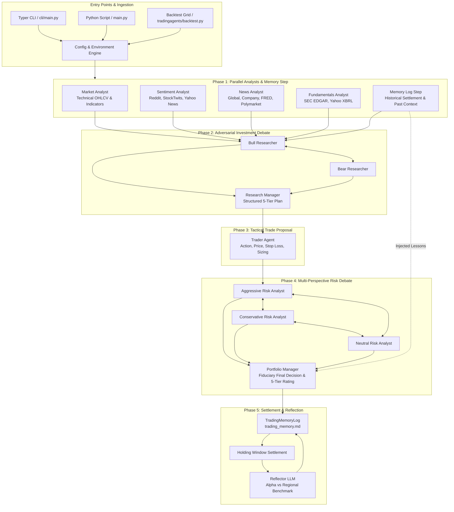
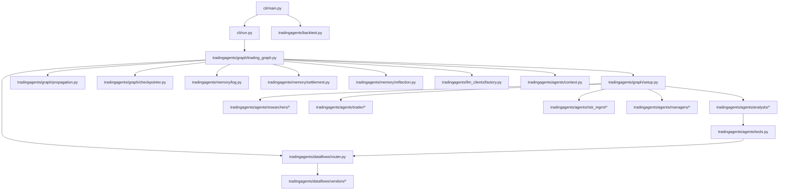
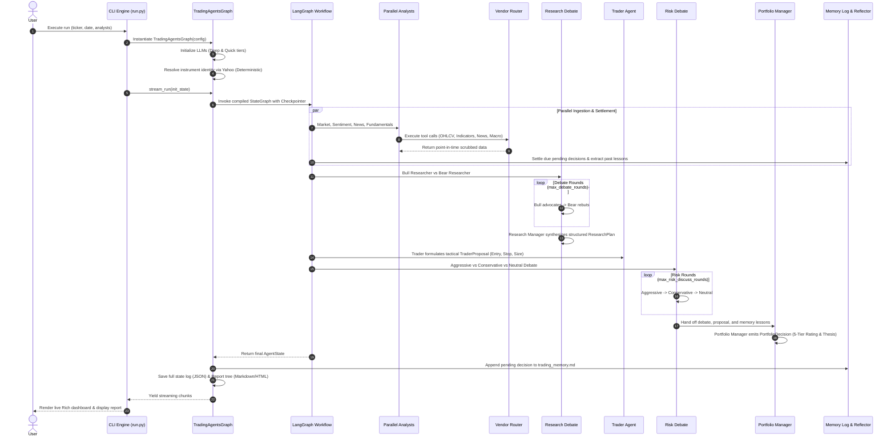
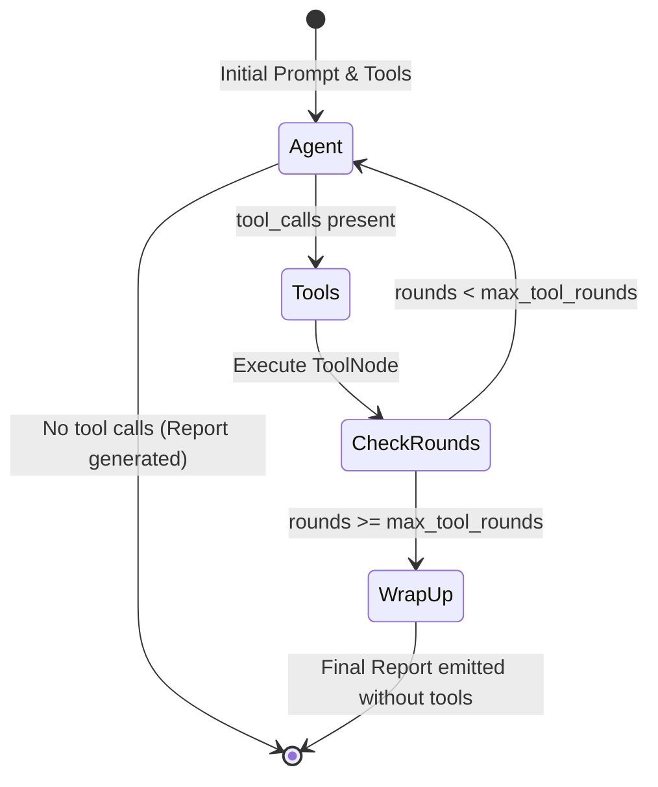
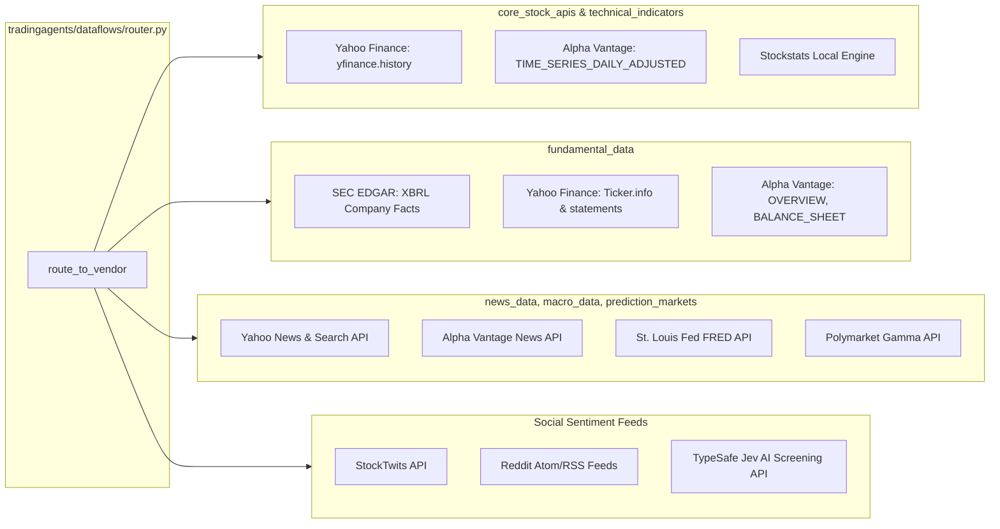
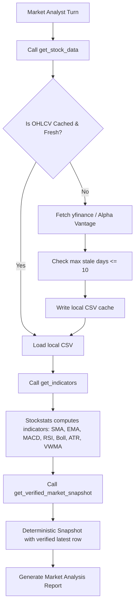
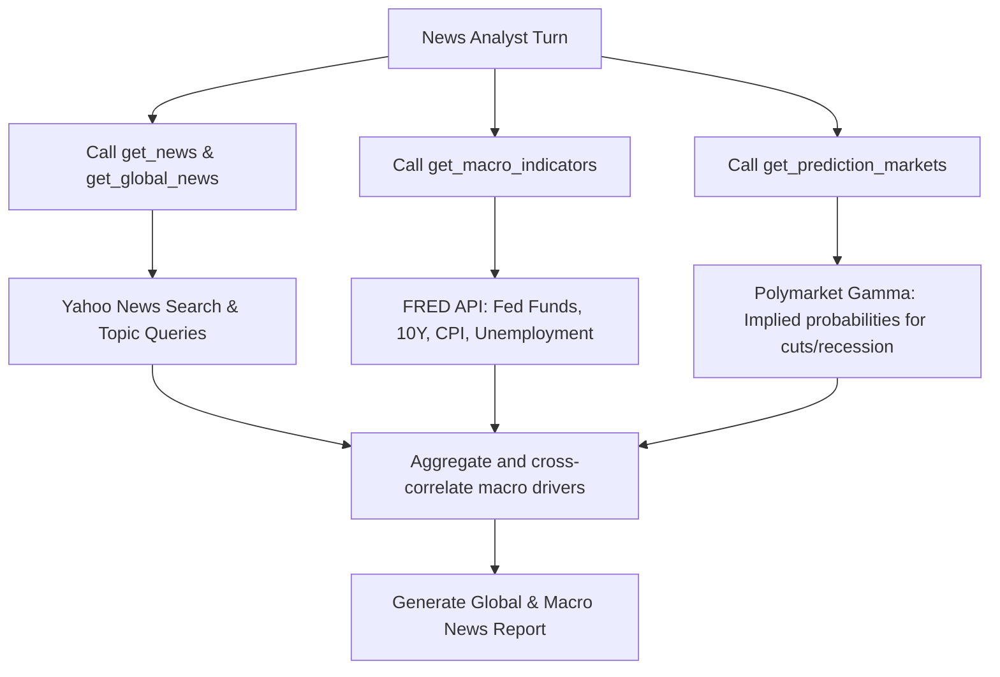

# PROJECT ARCHITECTURE & REVERSE ENGINEERING SPECIFICATION
**TradingAgents: Multi-Agent LLM Financial Trading Framework**

---

## 1. Executive Summary & Architecture Overview

**TradingAgents** is a production-grade multi-agent autonomous trading system built on top of **LangGraph**, **LangChain**, and **Pydantic**. It coordinates specialized AI personas across market analysis, social and news sentiment, corporate fundamentals, adversarial investment debates, quantitative trading execution, dynamic risk management, and self-reflective memory learning.

The system is designed with strict point-in-time temporal guarantees to eliminate lookahead bias during historical runs and backtesting, and incorporates dual-tier LLM intelligence (Quick-Thinking for high-throughput analyst turns and Deep-Thinking for complex fiduciary synthesis).



---

## 2. Repository Folder Structure

```
TradingAgents-main/
├── .env.example                               # Template for API keys and environment overrides
├── CHANGELOG.md                               # Project release and modification history
├── Dockerfile                                 # Container build definition for containerized runs
├── docker-compose.yml                         # Multi-container service definitions
├── LICENSE                                    # Apache 2.0 license
├── main.py                                    # Programmatic execution script entry point
├── pyproject.toml                             # Packaging, build system, dependencies, tool settings
├── requirements.txt                           # Forwarding pointer to pyproject.toml (pip install .)
├── assets/                                    # Architectural diagrams and CLI preview screenshots
├── cli/                                       # Command-Line Interface (Typer & Rich)
│   ├── __init__.py                            # Module exports
│   ├── display.py                             # Rich Live UI layout, terminal streaming, markdown rendering
│   ├── main.py                                # CLI entry point (analyze, backtest, login, logout)
│   ├── models.py                              # CLI data enums (AnalystType, AssetType)
│   ├── prefs.py                               # Persistent user selection preferences manager
│   ├── prompts.py                             # Interactive questionary dialogs and input sanitizers
│   ├── run.py                                 # Runtime controller, stream processing, report orchestration
│   ├── selections.py                          # User selection builder, environment resolution
│   ├── stats_handler.py                       # LangChain callback handler for token and cost metrics
│   ├── static/                                # Static terminal banner assets
│   │   └── welcome.txt                        # ASCII art welcome header
│   └── updates.py                             # In-app version checking and upgrade notifications
├── tests/                                     # Comprehensive Pytest test suite (unit & integration)
│   ├── conftest.py                            # Pytest fixtures and mock configurations
│   ├── test_analyst_execution.py              # Analyst execution plan tests
│   ├── test_checkpoint_lifecycle.py           # LangGraph checkpoint persistence tests
│   ├── test_crypto_asset_mode.py              # Cryptocurrency asset handling and analyst filters
│   ├── test_graph_end_to_end.py               # End-to-end dry-run graph verification
│   ├── test_layering.py                       # Architectural dependency isolation tests
│   ├── test_memory_pointintime.py             # Point-in-time memory settlement tests
│   ├── test_sec_edgar.py                      # SEC EDGAR XBRL extraction tests
│   ├── test_symbols.py                        # Symbol normalization tests (crypto, forex, indices)
│   └── ...                                    # Additional unit test suites
└── tradingagents/                             # Core framework package
    ├── __init__.py                            # Package version export (__version__ = "0.2.0")
    ├── backtest.py                            # Multi-ticker, multi-date evaluation matrix engine
    ├── default_config.py                      # Master configuration dictionary and env coercion
    ├── portfolio.py                           # Position and PortfolioContext models
    ├── report_html.py                         # Standalone HTML report generator
    ├── reporting.py                           # Multi-section markdown report tree generator
    ├── assets/                                # Embedded brand assets
    │   └── tauric-logo.svg                    # SVG logo for generated HTML reports
    ├── agents/                                # Agent implementations, prompts, schemas, state
    │   ├── __init__.py                        # Agent factory re-exports
    │   ├── context.py                         # Instrument identity and prompt context injection
    │   ├── post_screen.py                     # TypeSafe Jev LLM-based social post screening
    │   ├── rating.py                          # Rating parser and verification routines
    │   ├── schemas.py                         # Pydantic structured output models
    │   ├── state.py                           # LangGraph AgentState and sub-debate TypedDicts
    │   ├── structured.py                      # Structured output wrappers and free-text fallbacks
    │   ├── tools.py                           # LangChain tool definitions offered to analysts
    │   ├── analysts/                          # Specialized analytical agents
    │   │   ├── __init__.py                    # Factory re-exports
    │   │   ├── fundamentals_analyst.py        # SEC EDGAR and Yahoo corporate financials analyst
    │   │   ├── market_analyst.py              # OHLCV price action and technical indicators analyst
    │   │   ├── news_analyst.py                # Macro, company news, FRED, Polymarket analyst
    │   │   ├── sentiment_analyst.py           # Multi-source social sentiment analyst
    │   │   └── turn.py                        # Tool-calling turn loop & WRAP_UP governor
    │   ├── managers/                          # Fiduciary decision-maker agents
    │   │   ├── __init__.py                    # Factory re-exports
    │   │   ├── portfolio_manager.py           # Final rating, executive summary, thesis synthesis
    │   │   └── research_manager.py            # Bull/bear debate synthesizer and investment planner
    │   ├── researchers/                       # Adversarial investment debate researchers
    │   │   ├── __init__.py                    # Factory re-exports
    │   │   ├── bear_researcher.py             # Downside, risk, skepticism advocate
    │   │   └── bull_researcher.py             # Upside, growth, catalyst advocate
    │   ├── risk_mgmt/                         # Multi-perspective risk debate debaters
    │   │   ├── __init__.py                    # Factory re-exports
    │   │   ├── aggressive_debator.py          # High-alpha, aggressive upside champion
    │   │   ├── conservative_debator.py        # Capital preservation and drawdown mitigator
    │   │   └── neutral_debator.py             # Balanced risk/reward and portfolio stabilizer
    │   └── trader/                            # Execution planning agent
    │       ├── __init__.py                    # Factory re-exports
    │       └── trader.py                      # Tactical action, entry, stop loss, sizing planner
    ├── dataflows/                             # Ingestion pipelines, vendor routing, sanitization
    │   ├── __init__.py                        # Dataflow exports
    │   ├── config.py                          # Context-local data configuration scope
    │   ├── date_window.py                     # Point-in-time guards, window trimming, lookahead guards
    │   ├── errors.py                          # Typed vendor and market data exception hierarchy
    │   ├── files.py                           # Atomic file locks and safe file replacers
    │   ├── net.py                             # Network reachability and URL scrubbers
    │   ├── router.py                          # Central multi-vendor data dispatch table
    │   ├── symbols.py                         # Canonical symbol normalization and path sanitization
    │   └── vendors/                           # Upstream market data adapters
    │       ├── __init__.py                    # Vendor exports
    │       ├── fred.py                        # St. Louis Fed FRED macroeconomic time series
    │       ├── polymarket.py                  # Polymarket Gamma prediction markets API
    │       ├── reddit.py                      # Reddit Atom/RSS public feed extractor
    │       ├── sec_edgar.py                   # US SEC EDGAR XBRL company facts extractor
    │       ├── stocktwits.py                  # StockTwits public symbol stream extractor
    │       ├── alpha_vantage/                 # Alpha Vantage vendor adapter
    │       │   ├── __init__.py                # Alpha Vantage exports
    │       │   ├── common.py                  # Request retry and HTTP error handlers
    │       │   ├── fundamentals.py            # Balance sheet, income statement, cashflow
    │       │   ├── indicator.py               # Technical indicators (RSI, MACD, SMA, etc.)
    │       │   ├── news.py                    # News and sentiment endpoint
    │       │   └── stock.py                   # OHLCV price series
    │       └── yahoo/                         # Yahoo Finance vendor adapter
    │           ├── __init__.py                # Yahoo exports
    │           ├── common.py                  # Rate-limiting retry decorators and helpers
    │           ├── fundamentals.py            # Ticker.info, statements, insider trades
    │           ├── market.py                  # Daily OHLCV and stockstats calculations
    │           ├── news.py                    # yfinance news extraction and search fallback
    │           ├── ohlcv.py                   # CSV cache loader and staleness validators
    │           └── snapshot.py                # Deterministic market verification snapshot
    ├── graph/                                 # LangGraph orchestration engine
    │   ├── __init__.py                        # Orchestrator exports
    │   ├── analyst_execution.py               # Execution planner for selected analysts
    │   ├── checkpointer.py                    # SQLite per-ticker persistence and state resume
    │   ├── conditional_logic.py               # Dynamic debate routing and termination conditions
    │   ├── propagation.py                     # State initializer and graph invoke arguments
    │   ├── setup.py                           # StateGraph construction and edge wiring
    │   └── trading_graph.py                   # Main TradingAgentsGraph lifecycle coordinator
    ├── llm_clients/                           # Unified multi-provider LLM interface
    │   ├── __init__.py                        # Factory exports
    │   ├── api_key_env.py                     # Environment variable mapping per provider
    │   ├── base_client.py                     # BaseLLMClient abstract class and response normalizers
    │   ├── capabilities.py                    # Per-model capability matrix (structured, reasoning)
    │   ├── chatgpt_auth.py                    # PKCE OAuth authentication for ChatGPT Plus/Pro
    │   ├── factory.py                         # Lazy provider client factory and kwarg builder
    │   ├── model_catalog.py                   # Catalog of supported models and default selections
    │   ├── validators.py                      # Model validation and sanity checkers
    │   ├── anthropic_client.py                # Native Anthropic Claude client
    │   ├── azure_client.py                    # Azure OpenAI client
    │   ├── bedrock_client.py                  # Amazon Bedrock client (SigV4 auth)
    │   ├── google_client.py                   # Google Gemini client
    │   └── openai_client.py                   # Unified OpenAI-compatible provider registry
    └── memory/                                # Experience accumulation and learning
        ├── __init__.py                        # Memory exports
        ├── log.py                             # TradingMemoryLog append-only markdown journal
        ├── reflection.py                      # Reflector agent for evaluating closed trades
        └── settlement.py                      # Holding period expiration and alpha scoring
```

---

## 3. System Architecture & Dependency Graph

### 3.1 External Python Dependencies
As declared in `pyproject.toml`:

| Dependency | Minimum Version | Architectural Responsibility |
|---|---|---|
| `langgraph` | `>=1.2.12` | Orchestrates the multi-agent cyclic state machine and execution graph |
| `langchain-core` | `>=1.6.5` | Standardized schemas, prompts, chat models, tools, and message types |
| `langchain-openai` | `>=1.6.6` | Client bindings for OpenAI, xAI, DeepSeek, OpenRouter, and local LLMs |
| `langchain-anthropic`| `>=1.7.4` | Client bindings for Anthropic Claude (Sonnet, Opus, Haiku) |
| `langchain-google-genai`| `>=4.4.0` | Client bindings for Google Gemini models |
| `langchain-aws` | `>=1.7.9` (optional) | Amazon Bedrock Converse API bindings |
| `langgraph-checkpoint-sqlite` | `>=3.1.1` | Local SQLite checkpoint store for fault-tolerant crash/resume |
| `pydantic` | Transitive | Strict runtime data validation and JSON schema generation |
| `stockstats` | `>=0.6.5` | Computes 13+ technical indicators over Pandas OHLCV series |
| `yfinance` | `>=1.7.0` | Primary market data ingestion (OHLCV, fundamentals, metadata) |
| `requests` | `>=2.32.4` | HTTP client for REST APIs (SEC EDGAR, FRED, Polymarket, StockTwits) |
| `pandas` | `>=3.0.6` | Time-series manipulation, data frame alignment, OHLCV normalization |
| `typer` | `>=0.21.0` | Command-line interface definition and flag parsing |
| `rich` | `>=14.0.0` | Terminal dashboard layout, real-time streaming display, formatted panels |
| `questionary` | `>=2.1.0` | Interactive terminal selection dialogs, checkboxes, input prompts |
| `python-dotenv` | `>=1.0.0` | Loads environment variables from `.env` |
| `markdown-it-py` | `>=4.0` | Markdown rendering engine for standalone HTML report generation |
| `cryptography` | `>=42.0` | Security routines for secure token storage and PKCE generation |

### 3.2 Inter-Module Dependency Graph



---

## 4. Entry Points & Execution Flow

### 4.1 Entry Points
1. **Interactive CLI**: `tradingagents` (invoked via `cli/main.py:app` -> `analyze`)
2. **Headless CLI**: `tradingagents --ticker NVDA --date 2026-09-01 --analysts market,news --save --show`
3. **Backtesting Matrix**: `tradingagents backtest NVDA,AAPL --start 2025-01-01 --end 2025-06-01 --every 7`
4. **Programmatic Python API**: `main.py` or importing `from tradingagents.graph.trading_graph import TradingAgentsGraph`

### 4.2 Comprehensive Execution Sequence



---

## 5. LangGraph Workflow & State Architecture

### 5.1 State Definitions (`tradingagents/agents/state.py`)

The graph state is modeled as an immutable dictionary extending LangGraph's `MessagesState`:

```python
class AgentState(MessagesState):
    company_of_interest: str      # Target instrument ticker
    asset_type: str               # Asset class ("stock" or "crypto")
    instrument_context: str       # Deterministic ground-truth identity
    trade_date: str               # Canonical YYYY-MM-DD trade date
    
    # Phase 1: Analyst Reports
    market_report: str            # Technical analysis report
    sentiment_report: str         # Multi-source sentiment report
    news_report: str              # World news, FRED, Polymarket report
    fundamentals_report: str      # Corporate financials report
    
    # Phase 2: Research Debate
    investment_debate_state: InvestDebateState  # Bull/Bear history & turns
    investment_plan: str          # Research Manager structured synthesis
    
    # Phase 3: Tactical Proposal
    trader_investment_plan: str   # Trader transaction proposal
    
    # Phase 4: Risk Debate & Final Synthesis
    risk_debate_state: RiskDebateState          # 3-way risk analyst history
    final_trade_decision: str     # Portfolio Manager markdown decision
    final_rating: str             # 5-tier rating (Buy/Overweight/Hold/Underweight/Sell)
    
    # Context & Memory
    past_context: str             # Lessons retrieved from past trades
    memory_note: str              # Diagnostic notes from memory settlement
    portfolio_context: str        # Caller holdings, cash, and positions
```

### 5.2 Sub-Graph Isolation & Tool Execution Loop

Each tool-using analyst runs inside an isolated sub-graph (`_analyst_graph`) to prevent tool output pollution:



---

## 6. Detailed Inventory: Agents, LLM Calls & Prompts

| Agent Name | Module File | LLM Tier | Tools Available | Structured Output Schema |
|---|---|---|---|---|
| **Market Analyst** | `agents/analysts/market_analyst.py` | Quick-Think | `get_stock_data`, `get_indicators`, `get_verified_market_snapshot` | Free-text with Markdown Table |
| **Sentiment Analyst**| `agents/analysts/sentiment_analyst.py` | Quick-Think | None (Pre-fetched in prompt) | `SentimentReport` (Pydantic) |
| **News Analyst** | `agents/analysts/news_analyst.py` | Quick-Think | `get_news`, `get_global_news`, `get_macro_indicators`, `get_prediction_markets` | Free-text with Markdown Table |
| **Fundamentals Analyst**| `agents/analysts/fundamentals_analyst.py`| Quick-Think | `get_fundamentals`, `get_balance_sheet`, `get_cashflow`, `get_income_statement`, `get_insider_transactions` | Free-text with Markdown Table |
| **Memory Step Agent** | `graph/trading_graph.py` | Quick-Think | Price fetchers (via settlement) | Internal Settlement Object |
| **Bull Researcher**| `agents/researchers/bull_researcher.py` | Quick-Think | None | Free-text conversational argument |
| **Bear Researcher**| `agents/researchers/bear_researcher.py` | Quick-Think | None | Free-text conversational argument |
| **Research Manager** | `agents/managers/research_manager.py` | Deep-Think | None | `ResearchPlan` (Pydantic) |
| **Trader Agent** | `agents/trader/trader.py` | Quick-Think | None | `TraderProposal` (Pydantic) |
| **Aggressive Analyst**| `agents/risk_mgmt/aggressive_debator.py`| Quick-Think | None | Free-text conversational argument |
| **Conservative Analyst**| `agents/risk_mgmt/conservative_debator.py`| Quick-Think | None | Free-text conversational argument |
| **Neutral Analyst**| `agents/risk_mgmt/neutral_debator.py`| Quick-Think | None | Free-text conversational argument |
| **Portfolio Manager**| `agents/managers/portfolio_manager.py` | Deep-Think | None | `PortfolioDecision` (Pydantic) |
| **Reflector Agent**| `memory/reflection.py` | Quick-Think | None | Terse 2-4 sentence lesson |
| **Jev Classifier** | `agents/post_screen.py` | TypeSafe API | None | Calibrated Probabilities |

### 6.1 Prompt Architecture & Behavioral Directives

1. **Anti-Hallucination & Grounding**: All agents receive a deterministic `instrument_context` stating the exact company name, sector, and exchange.
2. **Deterministic Snapshot Enforcement**: Market analyst prompt mandates calling `get_verified_market_snapshot` as the ultimate ground truth for price and indicator numbers.
3. **Strict Rating Scale**: Research Manager and Portfolio Manager are strictly bound to the 5-tier rating scale:
   - **Buy**: Strong conviction bull thesis; initiate or expand position
   - **Overweight**: Constructive view; incrementally add exposure
   - **Hold**: Balanced risk/reward or thin evidence; maintain exposure
   - **Underweight**: Cautious view; trim exposure
   - **Sell**: Strong conviction bear thesis; liquidate or avoid position
4. **Conflict Resolution Directive**: Prompts explicitly state that *conflict in debate is not a reason to choose Hold*. Agents must weigh the stronger evidence.
5. **Point-in-Time Temporal Anchoring**: Every prompt receives `Today's date is {current_date}; treat it as 'now' for all analysis and tool-call date ranges`.

---

## 7. Data Ingestion, Vendors & APIs



### 7.1 Vendor Fallback Chains & Security
- **Strict Fallback Rules**: Vendors are configured via `data_vendors` in `default_config.py` (e.g. `"fundamental_data": "sec_edgar,yfinance"`). If the primary vendor fails or has no data, the request fails over in order.
- **Fail-Safe Sanitization**: If a vendor fails across the entire chain, typed errors (`VendorUnavailableError`, `NoMarketDataError`) return sentinel strings (`DATA_UNAVAILABLE`, `NO_DATA_AVAILABLE`) so LLMs do not hallucinate synthetic values.
- **Data Scrubbing**: URLs with credentials or API keys are stripped by `tradingagents/dataflows/net.py:get_scrubbed`.

---

## 8. Specific Analysis Flows

### 8.1 Technical Analysis Flow


### 8.2 News & Macro Flow


---

## 9. Identification of Every Stock-Specific Element

The codebase currently contains several implicit and explicit assumptions tailored strictly to public equities:

1. **Corporate Financial Statements**:
   - `Fundamentals Analyst` (`tradingagents/agents/analysts/fundamentals_analyst.py`) relies exclusively on balance sheets, income statements, cash flows, and insider transactions.
   - `tradingagents/dataflows/vendors/sec_edgar.py` only indexes US filers via CIK numbers.
   - `tradingagents/dataflows/vendors/yahoo/fundamentals.py` queries corporate valuation ratios: P/E, Forward P/E, PEG, Price-to-Book, Debt-to-Equity, Dividend Yield.
2. **Corporate Metadata & Entity Identity**:
   - `tradingagents/agents/context.py` assumes `sector`, `industry`, `exchange`, and corporate `company_name`.
3. **Social Community Targeting**:
   - `tradingagents/dataflows/vendors/reddit.py` defaults to `r/wallstreetbets`, `r/stocks`, and `r/investing`.
4. **Equity Benchmark & Alpha Assumption**:
   - `tradingagents/default_config.py` defaults benchmark mapping to `"SPY"` for un-suffixed tickers and equity indices (`^NSEI`, `^N225`, `^FTSE`, `^GDAXI`, etc.) for regional suffixes.
   - `tradingagents/memory/settlement.py` computes alpha as `raw_return - benchmark_return`. Comparing non-equity assets against `SPY` yields distorted alpha signals.
5. **Calendar & Market Session Assumptions**:
   - `tradingagents/dataflows/vendors/yahoo/ohlcv.py` and `settlement.py` assume equity market trading days (skipping weekends and market holidays).
6. **Symbol Normalization & Cashtags**:
   - `tradingagents/dataflows/symbols.py` treats un-suffixed 1-5 letter symbols as US equities.

---

## 10. Multi-Asset Adaptation Blueprint: BTC, XAUUSD, USDJPY

| Module / Component | Current Stock Implementation | Adaptation for BTC (Crypto) | Adaptation for XAUUSD (Gold) | Adaptation for USDJPY (Forex) |
|---|---|---|---|---|
| **Asset Type Classification** | `cli/prompts.py:detect_asset_type` defaults non-crypto to `stock` | Already detected as `crypto` | Add `commodity` classification for `XAUUSD`, `GC=F`, `GOLD` | Add `forex` classification for 6-letter currency pairs |
| **Symbol Normalization** | `symbols.py` maps `BTCUSD` -> `BTC-USD` | Mapped to `BTC-USD` (Yahoo) or `BTC.X` (StockTwits) | Currently mapped to `GC=F` (COMEX Gold Future) | Currently mapped to `USDJPY=X` |
| **Fundamentals Analyst** | Corporate 10-K/10-Q statements, balance sheet, insider trades | Filtered out. Replace with **On-Chain Analyst**: hashrate, active addresses, MVRV, Puell multiple, ETF net inflows | Replace with **Physical & Macro Fundamentals**: central bank gold reserves, World Gold Council flows, real yield curves (`DFII10`) | Replace with **Macro Interest Rate Parity Analyst**: Fed Funds vs BOJ Policy Rate, 10Y yield spreads, trade balance |
| **Benchmark & Alpha Scoring** | Defaults to `SPY` or regional equity index | Change benchmark to `BTC-USD` (for altcoins) or `CMC200` / `ETH-USD` | Change benchmark to `DXY` (US Dollar Index `DX-Y.NYB`) or inflation index | Change benchmark to `DXY` or trade-weighted currency basket |
| **Trading Calendar & Closes** | Standard equity business days (skipping weekends & holidays) | Adapt to **24/7/365 continuous trading calendar**; midnight UTC daily bars | Adapt to **24/5 futures/spot market calendar** (Sunday 6pm - Friday 5pm EST) | Adapt to **24/5 OTC Forex session calendar** (Sydney, Tokyo, London, NY) |
| **Social Sentiment Communities** | Defaults to `r/wallstreetbets`, `r/stocks`, `r/investing` | Already routes to `r/Bitcoin`, `r/CryptoCurrency`, `r/CryptoMarkets` | Adapt subreddits to `r/Gold`, `r/Silverbugs`, `r/Commodities` | Adapt subreddits to `r/Forex`, `r/CurrencyTrading` |
| **Price Precision & Quoting** | Floating dollar prices with 2 decimal places | Standard fiat quote ($XX,XXX.XX) or Satoshis | Quoted in Troy Ounce USD ($X,XXX.XX) | Quoted in Pips (3 to 5 decimal places, e.g. 154.250) |
| **Tactical Execution (Trader)** | Long equity position sizing, dollar stops | Fractional coin sizing, leverage/margin considerations | CFD/Futures lot sizing, tick value calculations | Pip-based stop loss, lot sizing (Standard/Mini/Micro lots) |

---

## 11. Configuration & Environment Reference

All system settings are consolidated in `tradingagents/default_config.py` and can be configured through environment variables:

```bash
# LLM Providers & Models
TRADINGAGENTS_LLM_PROVIDER=openai              # openai, anthropic, google, deepseek, groq, etc.
TRADINGAGENTS_DEEP_THINK_LLM=gpt-5             # Deep-thinking model for managers
TRADINGAGENTS_QUICK_THINK_LLM=gpt-5-mini       # Quick-thinking model for analysts/traders
TRADINGAGENTS_TEMPERATURE=0.1                  # Model temperature
TRADINGAGENTS_LLM_MAX_RETRIES=3                # SDK retry budget

# Workflow Depth & Limits
TRADINGAGENTS_MAX_DEBATE_ROUNDS=2              # Bull/Bear debate turns
TRADINGAGENTS_MAX_RISK_ROUNDS=2                # Risk debate turns
TRADINGAGENTS_MAX_TOOL_ROUNDS=20               # Max tool iterations per analyst
TRADINGAGENTS_CHECKPOINT_ENABLED=true          # Resumable SQLite checkpoints

# Data Vendor Routing
# Format: vendor or ordered fallback "vendor1,vendor2"
TRADINGAGENTS_RESULTS_DIR=~/.tradingagents/logs
TRADINGAGENTS_CACHE_DIR=~/.tradingagents/cache
TRADINGAGENTS_MEMORY_LOG_PATH=~/.tradingagents/memory/trading_memory.md
```

---

## 12. Verification & Architectural Integrity Rules

1. **Immutability of Historical Data**: Never allow live market data, present-day statements, or post-date news to enter a historical analysis run.
2. **Deterministic Precedence**: Tool-level configurations override category-level defaults; explicit CLI flags override environment variables; environment variables override `DEFAULT_CONFIG`.
3. **Structured Fallback Guarantee**: Every structured Pydantic agent must maintain a clean fallback to raw text parsing to ensure uninterrupted execution across diverse LLM providers.
4. **Fiduciary Debates**: Bull/Bear and Risk debates must never terminate early without completing their configured debate rounds or encountering explicit synthesis criteria.
5. **No Code Modification**: All future multi-asset implementations should follow modular vendor and adapter patterns without violating existing equity functionality.
