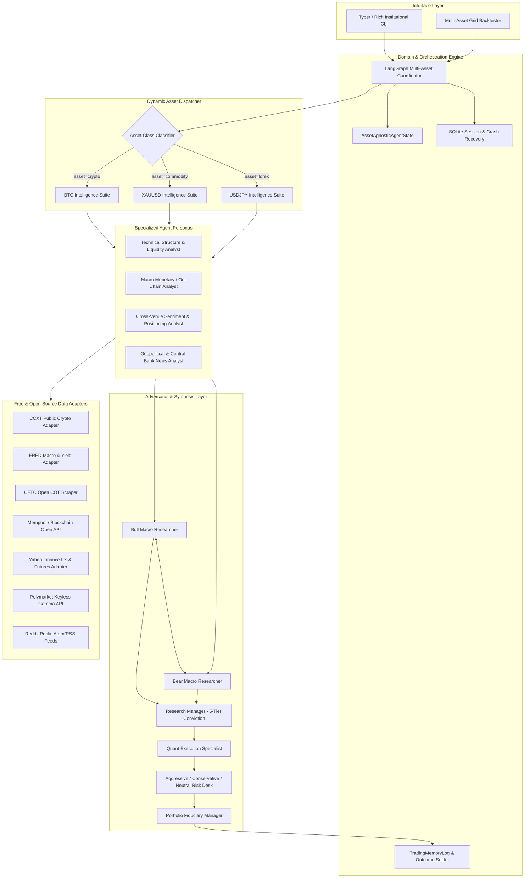
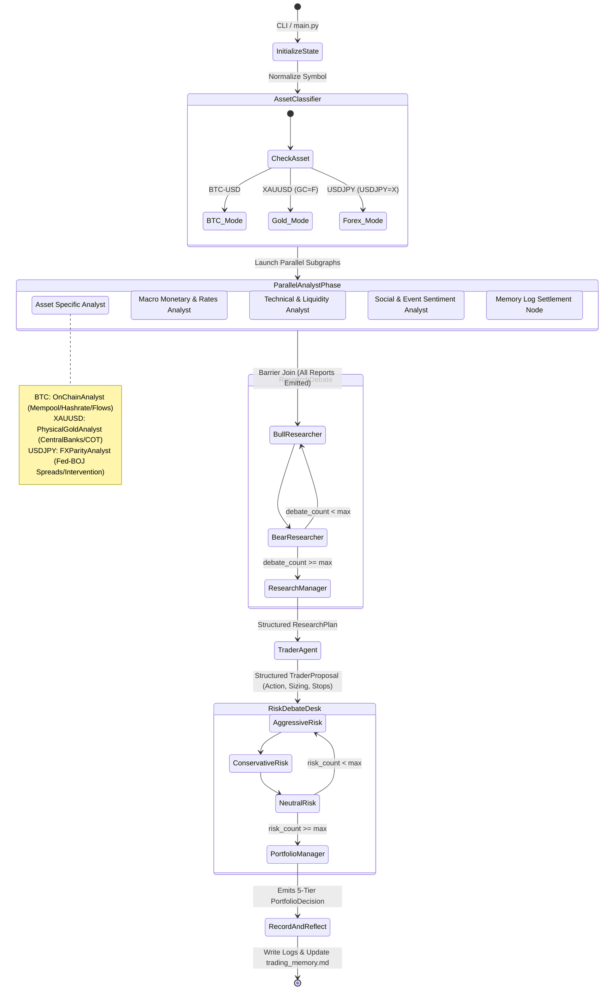
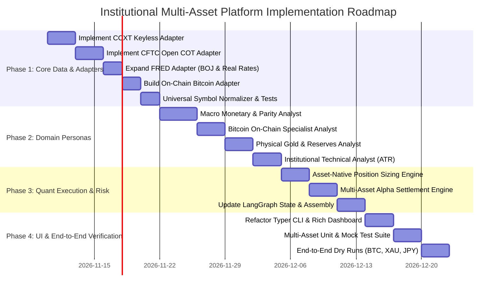

# SYSTEM DESIGN: INSTITUTIONAL TRADING INTELLIGENCE PLATFORM
**Multi-Asset Intelligence Architecture for BTC, XAUUSD, and USDJPY**
*Document Version: 1.0.0 | Status: Draft / Architecture Plan | Author: Lead AI Systems Architect & Quant Developer*

---

## 1. Executive Summary & Strategic Pivot

### 1.1 The Pivot: From Stock Analysis to Institutional Trading Intelligence
The legacy repository was built primarily around single-stock corporate equities (analyzing SEC filings, 10-K/10-Q reports, balance sheets, P/E ratios, and corporate insider trades, with `SPY` as the universal alpha benchmark). 

This system design pivots the codebase into an **Institutional Trading Intelligence Platform** purpose-built for three global macro and digital assets:
1. **BTC (Bitcoin)**: Digital store of value, high-beta global liquidity barometer, 24/7 continuous trading.
2. **XAUUSD (Spot Gold)**: Sovereign monetary reserve, ultimate hedge against fiat debasement and geopolitical tail risk, real-rate sensitive.
3. **USDJPY (US Dollar / Japanese Yen)**: Global foreign exchange benchmark, core carry trade vehicle, central bank monetary policy divergence indicator (Federal Reserve vs. Bank of Japan).

### 1.2 Core Architectural Principles
- **Strictly Free & Open-Source (FOSS)**: Zero proprietary paid market data APIs (no Bloomberg Terminal, no Refinitiv, no paid Glassnode/CoinMetrics plans, no paid Alpha Vantage premium tiers). All market data, on-chain metrics, macro indicators, and sentiment feeds leverage **free public endpoints, open-source libraries, and official government/exchange open APIs**.
- **Asset-Agnostic Core with Pluggable Asset Engines**: The LangGraph cyclic state machine, dual-tier LLM execution engine, SQLite checkpointer, and self-reflective memory log remain generic and reusable. Asset-specific domain knowledge is decoupled into pluggable modules.
- **Institutional Market Microstructure**: Replaces corporate accounting with asset-native mechanics:
  - Liquidity sessions (Asian, London, New York overlaps for FX).
  - Continuous 24/7 time-series aggregation without false holiday/weekend staleness flags.
  - Institutional position sizing (Standard/Mini/Micro FX lots, Troy Ounces/COMEX contracts, Satoshi/Coin fractions).
  - Macro-monetary fundamentals (Yield differentials, Real yields, Interest Rate Parity, On-chain network health, CFTC Commitments of Traders).

---

## 2. Asset Microstructure & Free Data Source Matrix

To achieve institutional-grade intelligence without paid APIs, the platform establishes dedicated open data pipelines for each asset class:

```
┌──────────────────────────────────────────────────────────────────────────────────────────────────────┐
│                                    FREE & OPEN-SOURCE DATA MATRIX                                    │
├─────────────────┬───────────────────────────────┬────────────────────────────────────────────────────┤
│ Target Asset    │ Analysis Dimension            │ Free & Open-Source Technology / Data Provider      │
├─────────────────┼───────────────────────────────┼────────────────────────────────────────────────────┤
│ **BTC**         │ OHLCV & Order Book            │ • `ccxt` (Free open-source library; Binance,       │
│                 │                               │   Coinbase, Kraken public REST endpoints, no key)  │
│                 │                               │ • Yahoo Finance (`yfinance: BTC-USD`)              │
│                 │ Derivatives & Funding         │ • Binance / Bybit public funding rates & open      │
│                 │                               │   interest endpoints (public REST, keyless)        │
│                 │ On-Chain Fundamentals         │ • Mempool.space API (hashrate, difficulty, fees)   │
│                 │                               │ • Blockchain.info public API (active addresses)    │
│                 │                               │ • DeFiLlama Free API (stablecoin cap, bridge flows)│
│                 │ Social Sentiment              │ • Reddit Atom/RSS (`r/Bitcoin`, `r/CryptoCurrency`)│
│                 │                               │ • StockTwits public stream (`BTC.X`)               │
│                 │ Prediction Markets            │ • Polymarket Gamma API (keyless, crypto topics)    │
├─────────────────┼───────────────────────────────┼────────────────────────────────────────────────────┤
│ **XAUUSD**      │ Spot & Futures Pricing        │ • Yahoo Finance (`GC=F` COMEX gold, `XAUUSD=X`)    │
│                 │ Macro / Real Rates            │ • St. Louis Fed FRED API (Free key):               │
│                 │                               │   - `DFII10` (10Y Real Treasury Yield)             │
│                 │                               │   - `T10YIE` (10Y Breakeven Inflation Rate)        │
│                 │                               │   - `GOLDAMGBD228NLBM` (LBMA PM Fixing)            │
│                 │ Currency Valuation            │ • FRED `DTWEXBGS` / Yahoo `DX-Y.NYB` (DXY Index)   │
│                 │ Institutional Positioning     │ • U.S. CFTC Public Disaggregated COT Report:       │
│                 │                               │   - Managed Money / Non-Commercial Net Positioning │
│                 │ Sentiment & Geopolitics       │ • Reddit (`r/Gold`, `r/Commodities`)               │
│                 │                               │ • Polymarket Gamma API (Fed cuts, war/sanctions)   │
├─────────────────┼───────────────────────────────┼────────────────────────────────────────────────────┤
│ **USDJPY**      │ Spot Exchange Rates           │ • Yahoo Finance (`USDJPY=X`)                       │
│                 │                               │ • European Central Bank / FRED FX reference rates  │
│                 │ Central Bank Monetary Policy  │ • FRED Macro Series:                               │
│                 │                               │   - `FEDFUNDS` / `DFF` (Fed Effective Funds Rate)  │
│                 │                               │   - `IRSTCI01JPM156N` (BOJ Policy Call Rate)       │
│                 │ Sovereign Yield Spreads       │ • FRED Sovereign 10Y Spreads:                      │
│                 │                               │   - US 10Y (`DGS10`) vs. Japan 10Y (`IRLTLT01JPM`) │
│                 │ Balance of Payments           │ • Ministry of Finance (MOF) Japan Public Bulletins │
│                 │ Volatility & FX Options       │ • FRED `EVZCLS` (Cboe EuroCurrency Volatility)     │
│                 │                               │ • Yahoo `^VIX`                                     │
│                 │ Sentiment & Macro News        │ • Global central bank speech transcripts           │
│                 │                               │ • Reddit (`r/Forex`, `r/CurrencyTrading`)          │
└─────────────────┴───────────────────────────────┴────────────────────────────────────────────────────┘
```

---

## 3. High-Level Modular Architecture

The platform architecture adopts a **Ports & Adapters (Hexagonal)** layout, decoupling core LangGraph reasoning from vendor data ingestion and asset-class specifics.



---

## 4. New Folder Structure

The repository structure is restructured from stock-centric folders into domain-driven modular packages:

```
TradingAgents-main/
├── README.md
├── SYSTEM_DESIGN.md                           # This architecture blueprint
├── PROJECT_ARCHITECTURE.md                   # Legacy reverse-engineering document
├── pyproject.toml                             # FOSS package requirements
├── .env.example                               # Environment template (free API keys only)
├── main.py                                    # Programmatic execution runner
│
├── cli/                                       # Institutional Terminal Dashboard
│   ├── main.py                                # Typer CLI entry point
│   ├── run.py                                 # Stream listener & Rich live display
│   ├── display.py                             # Institutional multi-panel layout
│   ├── models.py                              # AssetClass, ExecutionMode, AnalystType
│   ├── prompts.py                             # Input prompts & symbol normalizer
│   └── prefs.py                               # Terminal preference manager
│
├── tradingagents/
│   ├── __init__.py
│   ├── default_config.py                      # Multi-asset defaults & env mapping
│   ├── portfolio.py                           # Multi-asset position & cash management
│   ├── reporting.py                           # Multi-asset institutional reports
│   ├── report_html.py                         # HTML report generator with KaTeX/Charts
│   ├── backtest.py                            # Asset-aware backtesting & scoring
│   │
│   ├── graph/                                 # Orchestration & State Machine
│   │   ├── trading_graph.py                   # Central TradingAgentsGraph coordinator
│   │   ├── setup.py                           # StateGraph assembly & conditional routing
│   │   ├── state.py                           # InstitutionalAgentState TypedDict
│   │   ├── conditional_logic.py               # Debate turn controller
│   │   ├── checkpointer.py                    # SQLite state checkpointing
│   │   └── propagation.py                     # Initial state builders
│   │
│   ├── agents/                                # Agent Personas & Decision Logic
│   │   ├── context.py                         # Asset metadata & session context injection
│   │   ├── schemas.py                         # Pydantic schemas (Trader, PM, RM)
│   │   ├── structured.py                      # Resilient structured-output wrappers
│   │   ├── rating.py                          # 5-tier conviction rating parser
│   │   │
│   │   ├── analysts/                          # Phase 1: Analytical Specialists
│   │   │   ├── technical_analyst.py           # Multi-asset technical structure & ATR
│   │   │   ├── macro_monetary_analyst.py      # Yield spreads, real rates, central banks
│   │   │   ├── onchain_analyst.py             # BTC network metrics, hashrate, flows
│   │   │   ├── positioning_analyst.py         # CFTC COT, funding rates, open interest
│   │   │   ├── sentiment_analyst.py           # Social sentiment (Reddit, StockTwits)
│   │   │   └── turn.py                        # Tool execution & recursion controller
│   │   │
│   │   ├── researchers/                       # Phase 2: Adversarial Debate
│   │   │   ├── bull_researcher.py             # Bullish macro & structural advocate
│   │   │   └── bear_researcher.py             # Bearish macro & downside advocate
│   │   │
│   │   ├── managers/                          # Phase 2 & 4: Strategic & Fiduciary
│   │   │   ├── research_manager.py            # Synthesizes debate into ResearchPlan
│   │   │   └── portfolio_manager.py           # Final fiduciary PortfolioDecision
│   │   │
│   │   ├── trader/                            # Phase 3: Tactical Trade Execution
│   │   │   ├── trader.py                      # Generates orders, entry, stop, sizing
│   │   │   └── sizing.py                      # Lot / Coin / Ounce quant calculators
│   │   │
│   │   └── risk_mgmt/                         # Phase 4: Risk Desk Debate
│   │       ├── aggressive_debator.py          # High-alpha, aggressive convexity analyst
│   │       ├── conservative_debator.py        # Tail-risk, drawdown-minimizing analyst
│   │       └── neutral_debator.py             # Sharpe-maximizing, risk-parity analyst
│   │
│   ├── dataflows/                             # Ingestion Engine & Ports
│   │   ├── router.py                          # Central vendor dispatcher & fallbacks
│   │   ├── symbols.py                         # Universal multi-asset symbol normalizer
│   │   ├── date_window.py                     # Lookahead guards & 24/7 calendar logic
│   │   ├── errors.py                          # Typed exception hierarchy
│   │   ├── files.py                           # Cross-process file locking
│   │   ├── net.py                             # HTTP retries & credential scrubbing
│   │   │
│   │   └── adapters/                          # Concrete FOSS Vendor Implementations
│   │       ├── base.py                        # Abstract Base Adapter interface
│   │       ├── ccxt_adapter.py                # Public CCXT adapter (Binance/Coinbase)
│   │       ├── yahoo_adapter.py               # Yahoo Finance (Prices, Closes, News)
│   │       ├── fred_adapter.py                # FRED API (Macro, Real Rates, BOJ)
│   │       ├── cftc_cot_adapter.py            # Public CFTC COT report extractor
│   │       ├── onchain_adapter.py             # Mempool.space & Blockchain.info API
│   │       ├── polymarket_adapter.py          # Polymarket keyless Gamma API
│   │       └── reddit_adapter.py              # Reddit Atom/RSS public feed parser
│   │
│   ├── llm_clients/                           # Unified Dual-Tier LLM Drivers
│   │   ├── factory.py                         # Quick & Deep tier client factory
│   │   ├── base_client.py                     # Base client interface
│   │   ├── capabilities.py                    # Structured output & reasoning catalog
│   │   ├── openai_client.py                   # OpenAI / DeepSeek / Ollama / Local
│   │   ├── anthropic_client.py                # Anthropic Claude client
│   │   ├── google_client.py                   # Google Gemini client
│   │   └── chatgpt_auth.py                    # Free ChatGPT personal OAuth PKCE
│   │
│   └── memory/                                # Experiential Learning & Settlement
│       ├── log.py                             # TradingMemoryLog markdown journal
│       ├── settlement.py                      # Asset-aware alpha & return settlement
│       └── reflection.py                      # LLM self-reflection engine
│
└── tests/                                     # Comprehensive Unit & Integration Tests
    ├── unit/
    │   ├── test_symbols_multiasset.py         # BTC, XAUUSD, USDJPY normalization
    │   ├── test_ccxt_adapter.py               # Free crypto public endpoints
    │   ├── test_cftc_cot.py                   # Free COT extraction & parsing
    │   ├── test_macro_parity.py               # Yield spreads & interest rate parity
    │   └── test_sizing.py                     # Pip & lot size quantitative math
    └── integration/
        └── test_full_multiasset_graph.py      # End-to-end dry runs per asset
```

---

## 5. Component Migration Analysis

```
┌────────────────────────────────────────────────────────────────────────────────────────┐
│                              COMPONENT LIFECYCLE AUDIT                                 │
├──────────────────────────┬───────────────────────────┬─────────────────────────────────┤
│         KEEP             │          REPLACE          │             REMOVE              │
│  (100% Reusable Core)    │   (Adapt for Multi-Asset) │      (Stock-Specific Legacy)    │
├──────────────────────────┼───────────────────────────┼─────────────────────────────────┤
│ • LangGraph StateGraph   │ • Fundamentals Analyst    │ • SEC EDGAR XBRL Extractor      │
│ • SQLite Checkpointer    │ • Stock Market Analyst    │ • Corporate Balance Sheet Tools │
│ • Dual-Tier LLM Factory  │ • SPY Universal Benchmark │ • Corporate Cash Flow Tools     │
│ • Structured Output Wraps│ • Daily Stock Calendar    │ • Corporate Income Stmt Tools   │
│ • Adversarial Debate Loop│ • Equity Share Sizing     │ • Corporate Insider Trade Tools │
│ • 3-Way Risk Debate Desk │ • StockTwits Ticker Logic │ • Alpha Vantage Paid Modules    │
│ • TradingMemoryLog Core  │ • Subreddit Targeting     │ • TypeSafe Paid Jev Classifier  │
│ • Typer & Rich CLI Base  │ • Yahoo Fundamental Info  │ • P/E, PEG, Dividend Yield Math │
└──────────────────────────┴───────────────────────────┴─────────────────────────────────┘
```

### 5.1 Components to KEEP (High Architectural Value)
1. **LangGraph State Machine Engine** (`graph/setup.py`, `graph/trading_graph.py`): The parallel sub-graph execution model, recursion prevention governors (`WRAP_UP`), and barrier joins are completely asset-agnostic.
2. **Dual-Tier LLM Routing System** (`llm_clients/*`): Enables running high-speed models (Claude Haiku, GPT-4o-mini, Gemini Flash) for analytical nodes and deep-reasoning models (o3-mini, Gemini Pro Thinking, Claude Sonnet) for fiduciary nodes.
3. **Pydantic Structured Output Wrappers** (`agents/structured.py`, `agents/schemas.py`): Clean fallback from JSON schema tool-calls to free text guarantees zero crashed runs across all providers.
4. **SQLite Resumable Checkpointing** (`graph/checkpointer.py`): Thread-safe, per-ticker session resumption upon unexpected network/API drops.
5. **Experiential Memory Journal & Reflection Loop** (`memory/log.py`, `memory/reflection.py`): Capturing settled returns and prompting the model to reflect on errors produces compound learning.

### 5.2 Components to REPLACE (Asset-Class Adaptation)
1. **`fundamentals_analyst.py` $\rightarrow$ `macro_monetary_analyst.py` & `onchain_analyst.py`**:
   - *Current*: Queries corporate financial statements.
   - *Replacement*: Dispatches dynamically:
     - For **BTC**: Evaluates network hashrate, active addresses, exchange inflows/outflows, and mining profitability.
     - For **XAUUSD**: Evaluates real yields (`DFII10`), breakeven inflation (`T10YIE`), DXY strength, and central bank physical reserves.
     - For **USDJPY**: Evaluates Fed-BOJ policy rate divergence, US-Japan 10Y yield spreads, and terms-of-trade import balances.
2. **`symbols.py` $\rightarrow$ Universal Multi-Asset Normalizer**:
   - Explicit institutional translation rules:
     - `BTC`, `BTCUSD`, `BTC-USD`, `BTCUSDT` $\rightarrow$ `BTC-USD` (Yahoo) / `BTC/USDT` (CCXT).
     - `XAUUSD`, `GOLD`, `XAU` $\rightarrow$ `GC=F` (Yahoo) / `XAU/USD` (Cash spot).
     - `USDJPY`, `USD-JPY` $\rightarrow$ `USDJPY=X` (Yahoo) / `USD/JPY` (Interbank FX).
3. **`settlement.py` & `benchmark_map` $\rightarrow$ Multi-Asset Alpha Benchmark Engine**:
   - *Current*: Defaults all un-suffixed assets to `SPY` (S&P 500).
   - *Replacement*:
     - **BTC**: Compared against `BTC-USD` buy-and-hold (tactical timing alpha) or `ETH-USD` (crypto beta).
     - **XAUUSD**: Compared against `GC=F` or `DX-Y.NYB` (Dollar inverse alpha).
     - **USDJPY**: Compared against the trade-weighted dollar index (`DTWEXBGS`) or interest rate parity benchmark.
4. **`trader/trader.py` Sizing Logic $\rightarrow$ Asset-Class Quantitative Position Sizing**:
   - *Current*: Vague integer stock share sizing.
   - *Replacement*: Quantitative risk calculation based on account equity, asset-native units (Lots, Ounces, Satoshis), and ATR-based stop loss distances.

### 5.3 Components to REMOVE (Dead Weight & Paid APIs)
1. **`tradingagents/dataflows/vendors/sec_edgar.py`**: Completely irrelevant for BTC, Gold, and Forex.
2. **`tradingagents/dataflows/vendors/alpha_vantage/*`**: Alpha Vantage free tiers impose aggressive rate limits (25 requests/day), causing random run failures. Replaced with CCXT and direct FRED APIs.
3. **`tradingagents/agents/post_screen.py`**: Relies on TypeSafe Jev API (`TYPESAFE_API_KEY`). Replaced with open-source zero-shot prompt classification or free regex heuristics.
4. **Corporate statement tools in `tools.py`**: `get_balance_sheet`, `get_cashflow`, `get_income_statement`, `get_insider_transactions`.

---

## 6. Detailed Design of New Modules

### 6.1 `tradingagents/dataflows/adapters/ccxt_adapter.py`
Provides free, keyless, institutional-grade cryptocurrency market data via the open-source `ccxt` engine.

```python
"""CCXT Public Market Data Adapter (Free, Keyless)."""
import ccxt
import pandas as pd
from datetime import datetime

class CCXTPublicAdapter:
    def __init__(self, exchange_id: str = "binance"):
        self.exchange = getattr(ccxt, exchange_id)({"enableRateLimit": True})

    def fetch_ohlcv(self, symbol: str, timeframe: str = "1d", since: int | None = None, limit: int = 100) -> pd.DataFrame:
        """Fetch historical candlesticks from public exchange endpoints without API keys."""
        # symbol format: 'BTC/USDT'
        raw_bars = self.exchange.fetch_ohlcv(symbol, timeframe=timeframe, since=since, limit=limit)
        df = pd.DataFrame(raw_bars, columns=["timestamp", "Open", "High", "Low", "Close", "Volume"])
        df["Date"] = pd.to_datetime(df["timestamp"], unit="ms")
        return df[["Date", "Open", "High", "Low", "Close", "Volume"]]

    def fetch_funding_rate(self, symbol: str) -> dict:
        """Fetch current perpetual funding rate and predicted next rate."""
        if self.exchange.has.get("fetchFundingRate"):
            return self.exchange.fetch_funding_rate(symbol)
        return {"fundingRate": 0.0, "symbol": symbol}
```

### 6.2 `tradingagents/dataflows/adapters/cftc_cot_adapter.py`
Parses public, free weekly Commitments of Traders (COT) reports directly from the U.S. Commodity Futures Trading Commission.

```python
"""CFTC Commitments of Traders (COT) Open Data Adapter (Free, Public Domain)."""
import requests
import zipfile
import io
import pandas as pd

class CFTCCOTAdapter:
    """Extracts institutional smart-money positioning for COMEX Gold (GC) and JPY Futures."""
    COT_URL_CURRENT_YEAR = "https://www.cftc.gov/files/dea/history/deacot{year}.zip"

    def fetch_disaggregated_cot(self, market_name: str = "GOLD") -> dict:
        """Returns non-commercial / managed money net positioning and commercial hedger ratios.
        
        Institutional interpretation:
        - Managed Money Net Long > 85th percentile: Overheated retail/speculative extreme (contrarian bear).
        - Commercial Net Long > 80th percentile: Smart money accumulating (bullish confirmation).
        """
        # Downloads public text report, extracts market row, returns net positioning delta
        ...
```

### 6.3 `tradingagents/dataflows/adapters/onchain_adapter.py`
Connects to keyless, open on-chain APIs for Bitcoin network health.

```python
"""Bitcoin Open On-Chain Adapter (Keyless Public Endpoints)."""
import requests

class BitcoinOnChainAdapter:
    MEMPOOL_API = "https://mempool.space/api/v1"
    BLOCKCHAIN_INFO = "https://api.blockchain.info"

    def get_network_health(self) -> dict:
        """Fetch current network hashrate, mining difficulty, and mempool congestion."""
        diff_resp = requests.get(f"{self.MEMPOOL_API}/mining/difficulty-adjustments", timeout=10)
        mempool_resp = requests.get(f"{self.MEMPOOL_API}/fees/recommended", timeout=10)
        return {
            "difficulty": diff_resp.json() if diff_resp.ok else {},
            "recommended_fees": mempool_resp.json() if mempool_resp.ok else {},
        }
```

### 6.4 `tradingagents/agents/trader/sizing.py`
Replaces equity share sizing with asset-native institutional risk and position sizing algorithms.

```python
"""Institutional Multi-Asset Quantitative Position Sizing."""
import math
from typing import Literal

def calculate_position_size(
    account_equity: float,
    risk_percentage: float,
    entry_price: float,
    stop_loss_price: float,
    asset_class: Literal["crypto", "commodity", "forex"],
    ticker: str = "USDJPY"
) -> dict:
    """
    Computes strict volatility-adjusted position size ensuring maximum risk per trade
    never exceeds account_equity * risk_percentage.
    
    Returns native sizing:
    - Forex: Lots (1 Standard Lot = 100,000 units of base currency)
    - Gold: Ounces / Standard Contracts (100 oz per COMEX contract)
    - Bitcoin: Fraction of Coin (BTC) down to 8 decimal places (Satoshis)
    """
    risk_capital = account_equity * (risk_percentage / 100.0)
    price_risk = abs(entry_price - stop_loss_price)
    
    if price_risk <= 0:
        return {"error": "Stop loss cannot equal entry price."}

    if asset_class == "forex":
        # Example USDJPY: Pip size = 0.01 JPY
        is_jpy = "JPY" in ticker
        pip_size = 0.01 if is_jpy else 0.0001
        pips_at_risk = price_risk / pip_size
        
        # Standard lot pip value in quote currency
        # For USDJPY, pip value per standard lot = 1,000 JPY / current_rate USD
        pip_value_usd = (100_000 * pip_size) / entry_price if is_jpy else 10.0
        lots = risk_capital / (pips_at_risk * pip_value_usd)
        return {
            "sizing_type": "Forex Lots",
            "standard_lots": round(lots, 2),
            "units": int(lots * 100_000),
            "pips_at_risk": round(pips_at_risk, 1),
            "risk_usd": round(risk_capital, 2)
        }

    elif asset_class == "commodity": # Gold (XAUUSD)
        # $1 per ounce move = $100 per COMEX contract (100 oz)
        ounces = risk_capital / price_risk
        contracts = ounces / 100.0
        return {
            "sizing_type": "Gold Ounces & Contracts",
            "troy_ounces": round(ounces, 2),
            "contracts": round(contracts, 2),
            "risk_usd": round(risk_capital, 2)
        }

    elif asset_class == "crypto": # BTC
        btc_units = risk_capital / price_risk
        satoshis = int(btc_units * 100_000_000)
        return {
            "sizing_type": "Bitcoin Units",
            "btc": round(btc_units, 6),
            "satoshis": satoshis,
            "risk_usd": round(risk_capital, 2)
        }
```

---

## 7. Multi-Asset LangGraph Execution Workflow

The target LangGraph topology dynamically adjusts its analytical nodes based on the target asset class:



---

## 8. Implementation Roadmap

The transition is structured into **four manageable, non-destructive phases**:



### Phase 1: Core Infrastructure & FOSS Adapters
- Create `tradingagents/dataflows/adapters/` package.
- Implement keyless `ccxt_adapter.py` for public Binance/Coinbase OHLCV and funding rates.
- Implement `cftc_cot_adapter.py` for weekly gold/forex institutional positioning.
- Expand `fred_adapter.py` with BOJ interest rates, US-JP 10Y yield spreads, and 10Y Real Rates (`DFII10`).
- Implement `onchain_adapter.py` for Bitcoin difficulty and mempool fee estimates.
- Deprecate SEC EDGAR and Alpha Vantage dependencies.

### Phase 2: Domain-Specific Analytical Personas
- Create `macro_monetary_analyst.py`, `onchain_analyst.py`, and `positioning_analyst.py`.
- Update prompt templates to eliminate corporate equity terminology (P/E ratios, earnings calls).
- Inject asset-specific context: Central bank policy statements, halving cycles, and real-yield correlations.

### Phase 3: Quantitative Sizing & Settlement Refactoring
- Integrate `sizing.py` into `trader/trader.py` to produce native Lot, Ounce, and Coin order recommendations.
- Refactor `memory/settlement.py` and `default_config.py` to calculate alpha against asset-specific benchmarks rather than `SPY`.
- Adjust calendar logic in `date_window.py` to allow continuous 24/7 calculations for BTC without false staleness alerts.

### Phase 4: UI, Dashboard & End-to-End Verification
- Update Typer CLI commands in `cli/main.py` and `cli/prompts.py` to feature explicit asset class presets (`--asset crypto|commodity|forex`).
- Enhance Rich live dashboard in `cli/display.py` with pip displays, funding rate tables, and yield spread panels.
- Add comprehensive Pytest test suites validating zero-lookahead safety across BTC, XAUUSD, and USDJPY.

---

## 9. Architectural Integrity & Verification Rules

1. **Strict Cost Boundary**: Under no circumstances should proprietary paid APIs be added. Every data source must function either with zero authentication (public REST/Atom feeds) or with free-tier registration (FRED).
2. **Deterministic Fallbacks**: Every public API call must be guarded by timeout limits (10s max) and degrade gracefully to clear placeholder diagnostics rather than breaking graph execution.
3. **No Breakage of Shared Graph Mechanics**: The cyclic debate architecture (`Bull Researcher` $\leftrightarrow$ `Bear Researcher` $\rightarrow$ `Research Manager` $\rightarrow$ `Trader` $\rightarrow$ `Risk Desk` $\rightarrow$ `Portfolio Manager`) must be preserved in its entirety.
4. **Execution Sizing Grounding**: Stop-loss levels and position sizing recommendations generated by the Trader agent must be strictly mathematically consistent with account risk thresholds.
