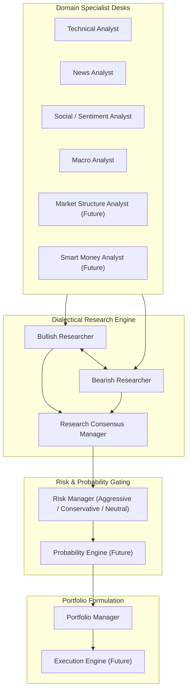

# Agent Architecture & Specialist Desks

*Document Version: 1.0.0 | Status: Architectural Specification | Scope: Multi-Agent Reasoning System*

---

## 1. Multi-Agent System Philosophy

The platform's analytical intelligence is organized around the concept of **Autonomous Specialist Desks** operating under an **Adversarial Dialectical Framework**.

Rather than relying on a single monolithic LLM prompt—which is prone to cognitive bias, hallucination, and superficial analysis—the platform decomposes institutional investment analysis into specialized domains. Each desk focuses strictly on its area of competence, generating structured findings that are subsequently evaluated by an adversarial research debate and stress-tested by a fiduciary risk management committee before execution.

---

## 2. Core Operational Desks

### 2.1 Technical Analyst Desk
- **Module**: `tradingagents/agents/analysts/market_analyst.py`
- **Role**: Quantitative price action, trend momentum, and volatility specialist.
- **Primary Responsibilities**:
  - Ingests high-frequency and daily OHLCV series.
  - Computes multi-timeframe moving averages (20, 50, 200 EMA/SMA).
  - Evaluates volatility regimes via Average True Range (ATR) and Bollinger Band width.
  - Identifies momentum divergences using Relative Strength Index (RSI) and MACD.
  - Detects key technical horizontal support/resistance levels and dynamic pivot points.
- **Inputs**: `OHLCVSeriesDTO`, `QuoteDTO`, `Timeframe`.
- **Outputs**: `TechnicalSignalDTO` containing trend direction (`BULLISH`, `BEARISH`, `NEUTRAL`), momentum score [-100, +100], key support/resistance price levels, and current volatility regime.

### 2.2 News Analyst Desk
- **Module**: `tradingagents/agents/analysts/news_analyst.py`
- **Role**: Global geopolitical, macroeconomic, and regulatory intelligence specialist.
- **Primary Responsibilities**:
  - Ingests chronological news feeds, wire reports, and regulatory filings within the validated date window.
  - Filters noise and identifies high-impact institutional catalysts (e.g. FOMC rate decisions, regulatory enforcement actions, sovereign reserve announcements).
  - Assesses the duration and structural severity of news catalysts (transitory vs secular impact).
- **Inputs**: `Sequence[NewsArticleDTO]`, `as_of_date`.
- **Outputs**: `NewsCatalystReportDTO` detailing top positive and negative catalysts, aggregate narrative sentiment, and critical event risk horizon.

### 2.3 Social & Sentiment Analyst Desk
- **Module**: `tradingagents/agents/analysts/social_analyst.py`
- **Role**: Crowd positioning, retail euphoria/panic detection, and prediction market analyst.
- **Primary Responsibilities**:
  - Analyzes retail sentiment velocity across social discussion streams (StockTwits, Reddit financial subreddits).
  - Ingests Polymarket prediction market odds on binary macroeconomic and monetary outcomes (e.g. Fed rate cuts, debt ceiling).
  - Identifies sentiment divergence (e.g., price making new highs while crowd sentiment drops, signaling distribution).
- **Inputs**: `SentimentScoreDTO`, Polymarket event odds.
- **Outputs**: `SentimentSignalDTO` containing crowd positioning index [-1.0, +1.0], contrarian extreme warnings (e.g., "Extreme Euphoria - Caution Longs"), and implied market event probabilities.

### 2.4 Macro Monetary & Rates Analyst Desk
- **Module**: `tradingagents/agents/analysts/fundamentals_analyst.py` (Extended for Macro)
- **Role**: Sovereign yield curve, monetary policy, and global liquidity specialist.
- **Primary Responsibilities**:
  - Tracks U.S. Treasury yield curves (2Y, 10Y, 30Y) and monitors inversion/steepening dynamics (`T10Y2Y`, `T10Y3M`).
  - Evaluates real yields (TIPS yields) and their direct negative correlation to Gold (XAUUSD).
  - Analyzes central bank policy divergence between the Federal Reserve and the Bank of Japan for USDJPY carry trade implications.
  - Assesses global M2 money supply growth and dollar liquidity indices (DXY) as macroeconomic drivers for Bitcoin (BTC).
- **Inputs**: `MacroSeriesDTO` from FRED (Fed Funds, CPI, M2, Treasury yields).
- **Outputs**: `MacroRegimeDTO` detailing liquidity regime (`EXPANSIONARY`, `CONTRACTIONARY`), real rate trajectory, yield curve slope, and cross-asset tailwinds/headwinds.

### 2.5 Risk Management Desk
- **Module**: `tradingagents/agents/risk_mgmt/`
- **Role**: Fiduciary capital preservation and tail-risk gatekeeper.
- **Primary Responsibilities**:
  - Coordinates a multi-persona risk committee:
    - **Aggressive Risk Persona**: Evaluates capital efficiency and upside capture.
    - **Conservative Risk Persona**: Enforces maximum allowable drawdown, Value at Risk (VaR), and tail-risk defense.
    - **Neutral Risk Persona**: Balances risk-adjusted returns (Sharpe/Sortino optimization).
  - Enforces mandatory position stop-loss rules based on multi-day ATR volatility multiples.
  - Restricts maximum capital exposure based on asset class volatility profiles.
- **Inputs**: Synthesized research thesis, current asset volatility, existing portfolio context.
- **Outputs**: `RiskAssessmentDTO` containing maximum allowable position size (basis points of portfolio), mandatory invalidation/stop-loss price level, and risk-reward hurdle ratio ($\ge 2.0$).

### 2.6 Portfolio Manager Desk
- **Module**: `tradingagents/agents/trader/`
- **Role**: Ultimate fiduciary decision-maker and trade plan formulator.
- **Primary Responsibilities**:
  - Synthesizes findings from all analytical desks, the adversarial research consensus, and the risk committee constraints.
  - Determines final trade action: `BUY`, `SELL`, or `HOLD` (cash preservation).
  - Constructs actionable execution parameters: Entry price, Stop-Loss price, Take-Profit 1 (conservative), and Take-Profit 2 (runner).
  - Documents the complete fiduciary trade thesis and assigns a structured confidence score [0% - 100%].
- **Inputs**: `ResearchConsensusDTO`, `RiskAssessmentDTO`, current market quotes.
- **Outputs**: `TradePlanDTO` ready for terminal presentation and execution.

---

## 3. Future Institutional Desks (Roadmap Extension)

To transition from an analytical assistant to an institutional-grade algorithmic intelligence platform, the following four specialist desks will be introduced in subsequent roadmap phases:

### 3.1 Market Structure Analyst Desk (Future - Milestone 2)
- **Role**: Order book liquidity, microstructure, and auction market theory specialist.
- **Responsibilities**:
  - Analyzes L2 order book depth, bid-ask imbalances, and order flow toxicity (VPIN).
  - Evaluates volume profiles (Point of Control - POC, Value Area High/Low - VAH/VAL).
  - Identifies Fair Value Gaps (FVG) and institutional liquidity pools.
- **Primary Asset Focus**: BTC (Binance L2 depth) and XAUUSD (COMEX futures order book).

### 3.2 Smart Money & Institutional Positioning Analyst Desk (Future - Milestone 2)
- **Role**: Regulatory positioning and institutional flow tracker.
- **Responsibilities**:
  - Ingests weekly CFTC Commitments of Traders (COT) disaggregated reports.
  - Dissects Non-Commercial (Managed Money / Hedge Funds) vs Commercial (Producers / Hedgers) net positioning.
  - Calculates historical percentile crowding to identify asymmetric short-squeeze or long-liquidation risks in Gold and JPY futures.
- **Primary Asset Focus**: XAUUSD (Gold COT code `088691`) and USDJPY (JPY Futures code `097741`).

### 3.3 Probability Engine (Future - Milestone 3)
- **Role**: Mathematical expected value and statistical win-rate modeler.
- **Responsibilities**:
  - Converts qualitative agent debates into a rigorous probabilistic distribution.
  - Runs Monte Carlo simulations (10,000 paths) parameterized by current asset drift and implied volatility.
  - Computes Expected Value:
    $$\mathbb{E}[V] = (P_{\text{win}} \times R_{\text{win}}) - (P_{\text{loss}} \times R_{\text{loss}})$$
  - Gates trade execution: If $\mathbb{E}[V] \le 0$, the trade is automatically vetoed regardless of agent sentiment.

### 3.4 Execution Engine (Future - Milestone 3)
- **Role**: Algorithmic order execution and slippage minimizer.
- **Responsibilities**:
  - Slices large block orders into algorithmic execution schedules (TWAP, VWAP).
  - Monitors exchange latency, order book replenishment rates, and maker-taker fee structures.
  - Generates post-trade Transaction Cost Analysis (TCA) reports comparing actual fill prices against arrival benchmarks.

---

## 4. Agent Interaction & Data Contract Summary

| Agent | Key Inputs | Key Outputs | Downstream Consumers |
| :--- | :--- | :--- | :--- |
| **Technical Analyst** | OHLCV Series, Quotes | Technical Signal, Support/Resistance | Bull & Bear Researchers |
| **News Analyst** | Filtered News Articles | Catalysts, Regulatory Headwinds | Bull & Bear Researchers |
| **Social Analyst** | Sentiment Feeds, Polymarket | Crowd Index, Contrarian Warnings | Bull & Bear Researchers |
| **Macro Analyst** | FRED Series, Yield Curves | Macro Regime, Rate Differentials | Bull & Bear Researchers |
| **Bull/Bear Researchers**| Analytical Desk Signals | Adversarial Theses & Evidence | Research Manager |
| **Research Manager** | Adversarial Theses | Unified Research Consensus | Risk Management Desk |
| **Risk Manager** | Research Consensus, Volatility| Max Position Size, Stop-Loss | Portfolio Manager |
| **Portfolio Manager** | Research Consensus, Risk Limits| Actionable Trade Plan (SL, TP, Size) | Terminal Display / UI |
