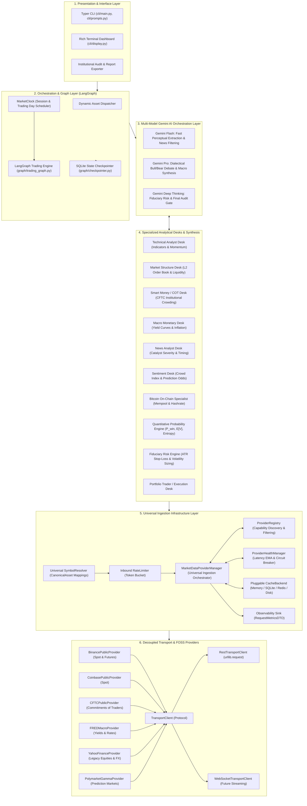
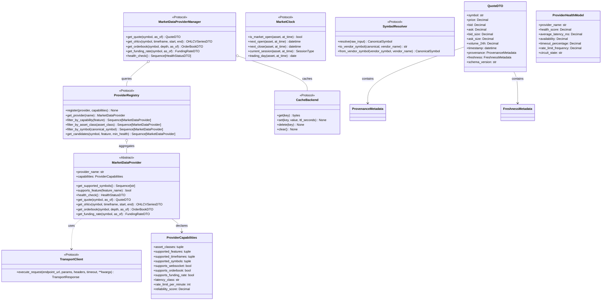
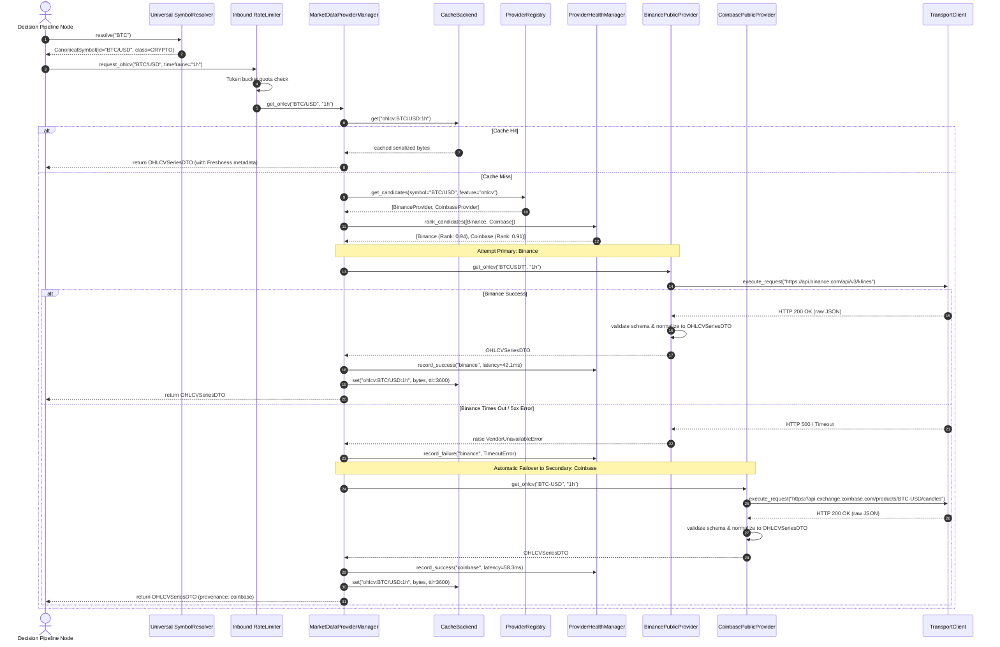
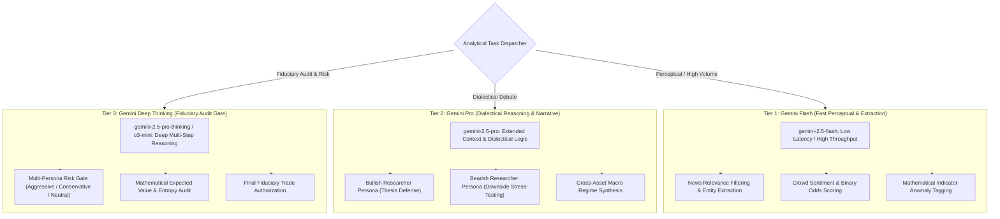

# Master Architecture: Institutional Multi-Asset AI Trading Intelligence Platform

**Target Global Assets:**
- **Bitcoin (BTC)**: Digital Liquidity & Store of Value
- **Gold (XAUUSD)**: Real Yield Hedge & Central Bank Reserve Asset
- **Forex (USDJPY, EURUSD, GBPUSD)**: Central Bank Monetary Policy & Carry Trade
- **Equities & Indices (S&P 500, NASDAQ, Blue-Chips)**: Corporate Fundamentals & Equity Risk Premia

**AI Engine**: Powered by Google Gemini Multi-Model Orchestration (Flash, Pro, Deep Thinking).

---

## 1. System Vision & Architectural Philosophy

The objective of the platform is **not simply collecting market data**. The objective is to build an institutional AI system capable of producing **statistically grounded, risk-adjusted probability distributions, confidence bounds, explainable fiduciary trade recommendations, and verifiable reasoning**.

The architecture enforces six core engineering principles:
1. **Separation of Concerns (SoC)**: Ingestion, normalization, analytical reasoning, consensus moderation, risk gating, and presentation are strictly decoupled.
2. **Unidirectional Dependency Graph**: Higher-level orchestrators depend upon domain abstractions; domain abstractions depend on low-level data vendors. Circular dependencies are strictly forbidden.
3. **Pluggable Discovery via Provider Registry**: The universal manager never directly imports concrete providers. Providers register dynamically with a central `ProviderRegistry` and declare explicit `ProviderCapabilities`.
4. **Transport Layer Decoupling**: Providers communicate through an injected `TransportClient` Protocol, completely isolated from raw socket or HTTP libraries.
5. **Strict Provider Purity (Zero Business Logic)**: Providers strictly fetch, validate, normalize, and return immutable DTOs with provenance and freshness metadata. They contain zero trading rules, indicators, or heuristics.
6. **100% Free & Open-Source (FOSS)**: Zero paid APIs. Built on keyless public REST/WebSocket endpoints and public domain data (CFTC, FRED).

---

## 2. High-Level System Architecture

---

## 3. Class Diagram: Core Contracts, Protocols & DTOs

---

## 4. Sequence Diagram: Dynamic Provider Discovery, Health Ranking & Failover

---

## 5. Multi-Model Gemini AI Orchestration Layer

The platform leverages Google Gemini's specialized model hierarchy to optimize latency, token efficiency, dialectical depth, and fiduciary safety:

