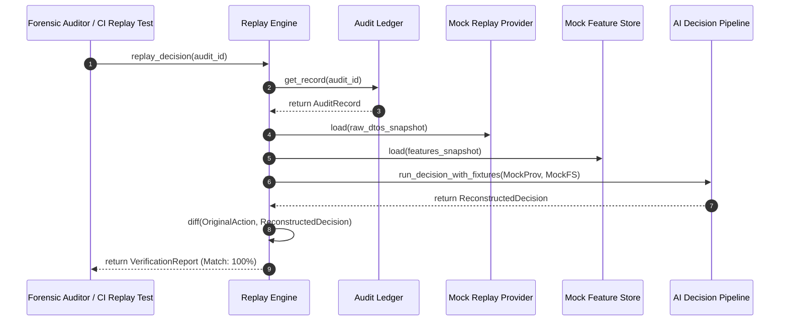

# Audit Trail & Deterministic Replay Specification

Version: 1.0.0  
Status: Architectural Blueprint (Phase 2)  
Audience: Compliance Engineers, AI Safety Researchers, Forensic Auditors  

---

## 1. Executive Summary & Regulatory Rationale

Institutional hedge funds and asset managers operating algorithmic or AI-directed systems are required by financial regulators (e.g. SEC, CFTC, FCA, ESMA) to maintain a complete, tamper-evident audit record of every trade recommendation and execution.

In an LLM-driven platform, non-deterministic model sampling and ephemeral network responses present significant forensic challenges. The **Audit Trail Subsystem** ensures:
1. **100% Deterministic Reproducibility**: Given an `audit_id`, the system can replay the exact state, features, prompt tokens, and temperature seeds to reconstruct why an AI decision was rendered.
2. **End-to-End Lineage**: Every execution links directly back to:
   - The exact raw vendor DTOs retrieved.
   - The derived features computed at that microsecond.
   - The exact prompt and system instructions passed to Gemini.
   - The raw JSON response returned by the LLM.
   - The quantitative risk gates applied.
3. **Tamper-Evident Hashing**: Audit records are cryptographically hashed (SHA-256) into an append-only ledger.

---

## 2. Audit Record Data Schema

```python
from dataclasses import dataclass, field
from datetime import datetime, timezone
from decimal import Decimal
from typing import Any, Dict, List, Optional, Protocol, Tuple, runtime_checkable
import hashlib
import json


@dataclass(frozen=True)
class AuditRecord:
    """Immutable, comprehensive forensic record for an AI trading decision."""
    audit_id: str                       # Unique UUID
    request_id: str                     # Pipeline orchestration trace ID
    timestamp: datetime                 # Precise UTC timestamp
    symbol: str                         # Canonical symbol (e.g. BTC/USDT)
    asset_class: str                    # Crypto, Forex, Commodities, Equities
    
    # 1. Market Data Provenance
    providers_used: Tuple[str, ...]     # e.g. ("binance", "coinbase")
    raw_dtos_snapshot: Dict[str, Any]   # Serialized QuoteDTO, OrderBookDTO, CandleDTO
    
    # 2. Point-in-Time Derived Features
    features_snapshot: Dict[str, Any]   # RSI, ATR, BOS, CHoCH, FVG, VWAP values
    
    # 3. Statistical & Risk Context
    bayesian_probability_up: Decimal
    bayesian_probability_down: Decimal
    portfolio_nav_usd: Decimal
    risk_limits_applied: Dict[str, Any] # VaR, max drawdown, single-asset cap
    
    # 4. LLM / Gemini Trace
    model_name: str                     # e.g. "gemini-1.5-pro", "gemini-1.5-flash"
    temperature: Decimal
    system_prompt: str
    user_prompt: str
    raw_llm_response: str
    token_usage: Dict[str, int]         # prompt_tokens, completion_tokens, total_tokens
    
    # 5. Output Trade Action & Hash
    action_recommended: str             # "LONG", "SHORT", "HOLD"
    target_entry: Optional[Decimal]
    stop_loss: Optional[Decimal]
    take_profit: Optional[Decimal]
    parent_record_hash: Optional[str]   # SHA-256 hash of previous block for immutability
    record_hash: str = ""

    def calculate_hash(self) -> str:
        """Compute SHA-256 digest of record contents."""
        content = {
            "audit_id": self.audit_id,
            "request_id": self.request_id,
            "timestamp": self.timestamp.isoformat(),
            "symbol": self.symbol,
            "providers_used": list(self.providers_used),
            "features_snapshot": self.features_snapshot,
            "raw_llm_response": self.raw_llm_response,
            "action_recommended": self.action_recommended,
            "parent_hash": self.parent_record_hash
        }
        serialized = json.dumps(content, sort_keys=True)
        return hashlib.sha256(serialized.encode("utf-8")).hexdigest()
```

---

## 3. Audit Trail Ledger & Replay Protocols

```python
@runtime_checkable
class AuditLedger(Protocol):
    """Protocol for recording and persisting immutable audit records."""

    def record_decision(self, record: AuditRecord) -> str:
        """Validate hash chain, append record to immutable log, and return audit_id."""
        ...

    def get_record(self, audit_id: str) -> Optional[AuditRecord]:
        """Fetch audit record by ID."""
        ...

    def query_records_by_symbol(
        self,
        symbol: str,
        start_time: datetime,
        end_time: datetime
    ) -> List[AuditRecord]:
        """Fetch range of audit records for backtesting and performance attribution."""
        ...


@runtime_checkable
class ReplayEngine(Protocol):
    """Protocol for deterministic historical re-simulation."""

    def replay_decision(self, audit_id: str) -> Dict[str, Any]:
        """
        Reconstruct exact state from audit record:
        1. Inject stored DTOs into a mock provider.
        2. Inject stored features into a mock feature store.
        3. Pass prompt to LLM harness in evaluation mode.
        4. Compare regenerated decision against original audit decision.
        """
        ...
```

---

## 4. Replay Architecture Flow



---

## 5. Storage & Retention Policy

- **Tier 1 (Hot In-Memory/Local NVMe)**: Retains records for the last 90 days for rapid querying and real-time dashboard inspection.
- **Tier 2 (Cold Compressed WORM Storage - Write Once Read Many)**: Compressed JSONL / Parquet archives retaining all records for a minimum of 7 years in compliance with SEC Rule 17a-4 and FINRA requirements.
