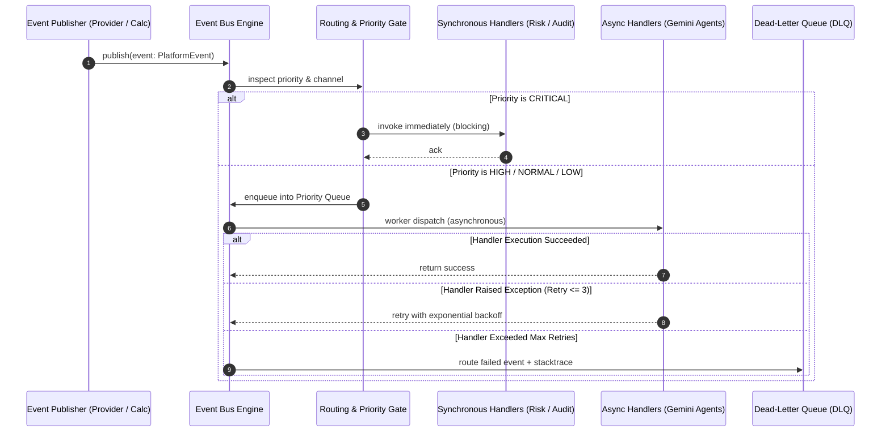

# Event Bus Architecture Specification

Version: 1.0.0  
Status: Architectural Blueprint (Phase 2)  
Audience: Systems Engineers, Quantitative Developers, AI Agent Orchestration Leads  

---

## 1. Overview & Objectives

In an institutional-grade, multi-asset trading platform, market feeds, analytical feature pipelines, risk engines, and AI agents must communicate without tight coupling. The **Event Bus** provides an asynchronous, non-blocking, typed event-driven backbone that decouples event producers (e.g. data providers, feature calculators, order gateways) from event consumers (e.g. Gemini LLM agents, risk gates, audit ledger).

### Key Architectural Principles
1. **Decoupled Asynchrony**: Producers emit immutable event records without knowledge of who consumes them.
2. **Type Safety & Immutability**: All events are strongly typed, frozen dataclasses containing monotonic timestamps, unique event IDs, and strict payload schemas.
3. **Deterministic Priority Routing**: Latency-critical events (e.g. risk breaches, emergency circuit breakers) supersede routine telemetry or sentiment updates.
4. **Resilience & Fault Isolation**: Subscriber failures are isolated and never crash publisher routines or starve competing subscribers.
5. **Replay & Audit Readiness**: Every event passed through the bus can be captured by the Audit Trail recorder for exact deterministic replay.

---

## 2. Event Taxonomy & Hierarchy

All events derive from an immutable base event `PlatformEvent`.

```
PlatformEvent (Base Frozen Dataclass)
├── Market Data Events
│   ├── PriceUpdated
│   ├── OHLCVUpdated
│   ├── FundingRateUpdated
│   └── OrderBookUpdated
├── Macro & Alternative Data Events
│   ├── MacroReleased
│   ├── NewsPublished
│   ├── SentimentUpdated
│   └── OnChainUpdated
├── Intelligence & Decision Events
│   ├── FeatureCalculated
│   ├── ProbabilityCalculated
│   ├── RiskCalculated
│   └── TradeDecisionCreated
└── Execution & System Events
    ├── OrderSubmitted
    ├── OrderFilled
    ├── CircuitBreakerTriggered
    └── SystemAlertRaised
```

### Event Priority Tiers
The Event Bus enforces four explicit priority queues:
- **`CRITICAL` (Priority 0)**: Circuit breaker events, risk liquidation triggers, immediate kill-switches. Dispatched synchronously or head-of-queue.
- **`HIGH` (Priority 1)**: Real-time price updates, trade decisions, order fills.
- **`NORMAL` (Priority 2)**: OHLCV candle closes, macro releases, feature store updates.
- **`LOW` (Priority 3)**: Long-cycle news ingest, sentiment scoring, telemetry, background audits.

---

## 3. Data Contract & Event Schemas

```python
from dataclasses import dataclass, field
from datetime import datetime, timezone
from decimal import Decimal
from enum import Enum, IntEnum
from typing import Any, Dict, Optional, Protocol, runtime_checkable
import uuid


class EventPriority(IntEnum):
    CRITICAL = 0
    HIGH = 1
    NORMAL = 2
    LOW = 3


@dataclass(frozen=True)
class PlatformEvent:
    """Base class for all domain events across the platform."""
    event_id: str = field(default_factory=lambda: str(uuid.uuid4()))
    timestamp: datetime = field(default_factory=lambda: datetime.now(timezone.utc))
    priority: EventPriority = EventPriority.NORMAL
    correlation_id: Optional[str] = None
    source_component: str = "system"


# ---------------------------------------------------------
# Market Data Domain Events
# ---------------------------------------------------------

@dataclass(frozen=True)
class PriceUpdated(PlatformEvent):
    symbol: str = ""
    bid_price: Decimal = Decimal("0")
    ask_price: Decimal = Decimal("0")
    last_price: Decimal = Decimal("0")
    venue: str = ""
    priority: EventPriority = EventPriority.HIGH


@dataclass(frozen=True)
class OHLCVUpdated(PlatformEvent):
    symbol: str = ""
    timeframe: str = "1h"
    open_price: Decimal = Decimal("0")
    high_price: Decimal = Decimal("0")
    low_price: Decimal = Decimal("0")
    close_price: Decimal = Decimal("0")
    volume: Decimal = Decimal("0")
    candle_timestamp: Optional[datetime] = None


@dataclass(frozen=True)
class FundingRateUpdated(PlatformEvent):
    symbol: str = ""
    rate: Decimal = Decimal("0")
    predicted_rate: Optional[Decimal] = None
    funding_time: Optional[datetime] = None
    venue: str = ""


@dataclass(frozen=True)
class OrderBookUpdated(PlatformEvent):
    symbol: str = ""
    top_bids: tuple = ()  # tuple of (price, size)
    top_asks: tuple = ()  # tuple of (price, size)
    spread: Decimal = Decimal("0")
    mid_price: Decimal = Decimal("0")
    venue: str = ""


# ---------------------------------------------------------
# Macro & Intelligence Domain Events
# ---------------------------------------------------------

@dataclass(frozen=True)
class MacroReleased(PlatformEvent):
    series_id: str = ""
    metric_name: str = ""
    actual_value: Decimal = Decimal("0")
    forecast_value: Optional[Decimal] = None
    previous_value: Optional[Decimal] = None
    country: str = "US"


@dataclass(frozen=True)
class NewsPublished(PlatformEvent):
    symbol: str = ""
    headline: str = ""
    source: str = ""
    urgency: str = "REGULAR"
    raw_url: Optional[str] = None


@dataclass(frozen=True)
class SentimentUpdated(PlatformEvent):
    symbol: str = ""
    sentiment_score: Decimal = Decimal("0")  # -1.00 to +1.00
    confidence: Decimal = Decimal("0")       # 0.00 to 1.00
    source_model: str = "gemini-flash"


@dataclass(frozen=True)
class ProbabilityCalculated(PlatformEvent):
    symbol: str = ""
    p_up: Decimal = Decimal("0")
    p_flat: Decimal = Decimal("0")
    p_down: Decimal = Decimal("0")
    entropy: Decimal = Decimal("0")
    horizon: str = "24h"
    source_engine: str = "BayesianEnsemble"


@dataclass(frozen=True)
class RiskCalculated(PlatformEvent):
    symbol: str = ""
    account_id: str = ""
    max_position_size: Decimal = Decimal("0")
    recommended_stop_loss: Decimal = Decimal("0")
    var_99_usd: Decimal = Decimal("0")
    risk_approval: bool = False
    rejection_reason: Optional[str] = None
    priority: EventPriority = EventPriority.HIGH


@dataclass(frozen=True)
class TradeDecisionCreated(PlatformEvent):
    decision_id: str = ""
    symbol: str = ""
    action: str = "HOLD"  # "LONG", "SHORT", "HOLD"
    conviction: Decimal = Decimal("0")
    target_entry: Decimal = Decimal("0")
    stop_loss: Decimal = Decimal("0")
    take_profit: Decimal = Decimal("0")
    gemini_reasoning_summary: str = ""
    priority: EventPriority = EventPriority.HIGH
```

---

## 4. Event Bus Protocol & Dispatch Mechanics

```python
from typing import Callable, Coroutine, List, Union

EventHandler = Callable[[PlatformEvent], None]
AsyncEventHandler = Callable[[PlatformEvent], Coroutine[Any, Any, None]]


@runtime_checkable
class EventBus(Protocol):
    """Protocol defining the centralized decoupled Event Bus."""

    def publish(self, event: PlatformEvent) -> None:
        """Publish an event to all registered subscribers synchronously or queue for dispatch."""
        ...

    def subscribe(self, event_type: type, handler: Union[EventHandler, AsyncEventHandler]) -> None:
        """Register a subscriber callback for a specific PlatformEvent type."""
        ...

    def unsubscribe(self, event_type: type, handler: Union[EventHandler, AsyncEventHandler]) -> None:
        """Unregister a subscriber callback."""
        ...

    def publish_critical(self, event: PlatformEvent) -> None:
        """Immediate synchronous execution bypassing normal asynchronous queueing."""
        ...
```

---

## 5. Event Lifecycle & Flow



---

## 6. Error Handling, Retries & Dead-Letter Queue (DLQ)

1. **Subscriber Isolation**: If Subscriber A throws an unhandled exception, Subscriber B listening to the same event must still execute cleanly.
2. **Backoff Retries**: For transient consumer errors (e.g. LLM rate limit or temporary network hiccup during event processing):
   - Retry 1: 100ms
   - Retry 2: 400ms
   - Retry 3: 1600ms
3. **Dead-Letter Queue (DLQ)**:
   - If a subscriber fails 3 consecutive times, the event, the subscriber ID, the exception traceback, and original payload are wrapped into a `DeadLetterEnvelope` and saved to `DLQ`.
   - DLQ alerts trigger a `SystemAlertRaised` event with `EventPriority.HIGH`.

---

## 7. Sync vs Async Execution Model

| Dimension | Synchronous Mode (`publish_critical`) | Asynchronous Mode (`publish`) |
| :--- | :--- | :--- |
| **Execution Context** | Caller thread, blocking | Background event loop / worker pool |
| **Intended Use Case** | Risk liquidation, Stop-out, Kill-switch | Quote distribution, Agent debate, Telemetry |
| **Latency Target** | $< 1$ millisecond | $5 - 50$ milliseconds |
| **Exception Behavior** | Propagates directly to caller | Isolated, logged, pushed to DLQ |
