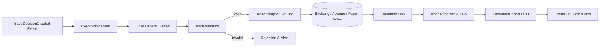

# Execution Architecture Specification

Version: 1.0.0  
Status: Architectural Blueprint (Phase 2)  
Audience: Execution Traders, Algo Engineers, Systems Architects  

---

## 1. Executive Summary & Separation of Concerns

An AI model should never execute trades directly on an exchange API. Generating a high-conviction trade thesis is a distinct responsibility from executing orders on an electronic venue:
- **Decision Layer (Gemini & Quant Engines)**: Determines *what* to trade, the directional conviction, and structural invalidation levels.
- **Execution Layer (Algo Engines & Broker Adapters)**: Determines *how* to route orders, minimize market impact, slice large blocks into discrete tranches, adhere to exchange precision rules, and record execution slippage.

The **Execution Architecture** cleanly decouples the AI decision pipeline from broker venues, providing an institutional execution harness with:
1. **Pre-Trade Validation**: Rigorous sanity checks on lot sizes, tick steps, margin requirements, and circuit breakers.
2. **Algorithmic Order Slicing**: TWAP, VWAP, and Iceberg order distribution to eliminate adverse market selection.
3. **Broker Agnosticism**: Abstract protocol allowing seamless swapping between Paper Trading, CCXT (Crypto), Interactive Brokers (Forex/Stocks/Commodities), or direct FIX gateways.
4. **Transaction Cost Analysis (TCA)**: Measuring execution quality, fill latency, and slippage against the decision benchmark price.

---

## 2. Component Architecture



---

## 3. Data Contracts & Data Transfer Objects

```python
from dataclasses import dataclass, field
from datetime import datetime, timezone
from decimal import Decimal
from enum import Enum
from typing import Any, Dict, List, Optional, Protocol, Tuple, runtime_checkable


class OrderType(Enum):
    LIMIT = "LIMIT"
    MARKET = "MARKET"
    STOP_MARKET = "STOP_MARKET"
    ICEBERG = "ICEBERG"
    TWAP = "TWAP"


class OrderSide(Enum):
    BUY = "BUY"
    SELL = "SELL"


class OrderStatus(Enum):
    PENDING = "PENDING"
    PARTIALLY_FILLED = "PARTIALLY_FILLED"
    FILLED = "FILLED"
    CANCELLED = "CANCELLED"
    REJECTED = "REJECTED"


@dataclass(frozen=True)
class ExecutionOrder:
    """Child order created by the execution planner."""
    order_id: str
    decision_id: str
    symbol: str
    venue: str
    side: OrderSide
    order_type: OrderType
    quantity: Decimal
    limit_price: Optional[Decimal]
    stop_price: Optional[Decimal]
    time_in_force: str = "GTC"  # GTC, IOC, FOK
    created_at: datetime = field(default_factory=lambda: datetime.now(timezone.utc))


@dataclass(frozen=True)
class ExecutionFill:
    """Individual trade execution fill reported by venue."""
    fill_id: str
    order_id: str
    symbol: str
    venue: str
    side: OrderSide
    fill_price: Decimal
    fill_quantity: Decimal
    commission_usd: Decimal
    timestamp: datetime


@dataclass(frozen=True)
class ExecutionReport:
    """Complete post-trade confirmation and TCA metrics."""
    execution_id: str
    decision_id: str
    symbol: str
    side: OrderSide
    requested_quantity: Decimal
    filled_quantity: Decimal
    average_fill_price: Decimal
    benchmark_decision_price: Decimal
    slippage_bps: Decimal               # (avg_fill - benchmark) / benchmark * 10,000
    total_commission_usd: Decimal
    status: OrderStatus
    start_time: datetime
    completed_time: datetime
    fills: Tuple[ExecutionFill, ...]
```

---

## 4. Execution Protocols

### A. TradeValidator Protocol
Performs hard pre-flight checks before an order touches any transport or broker socket.
```python
@runtime_checkable
class TradeValidator(Protocol):
    """Protocol for pre-trade risk and market invariant checks."""

    def validate_order(
        self,
        order: ExecutionOrder,
        portfolio_context: Any
    ) -> Tuple[bool, Optional[str]]:
        """
        Verify:
        1. Free margin is sufficient for order notional.
        2. Quantity aligns with exchange lot size and min notional.
        3. Price aligns with exchange tick size.
        4. Emergency kill switch is inactive.
        5. Venue market status is OPEN.
        """
        ...
```

### B. ExecutionPlanner Protocol
Translates a macro decision into optimal order slices.
```python
@runtime_checkable
class ExecutionPlanner(Protocol):
    """Protocol for slicing trade decisions into optimal child execution orders."""

    def plan_execution(
        self,
        decision_id: str,
        symbol: str,
        side: OrderSide,
        total_quantity: Decimal,
        urgency: str = "NORMAL"  # "AGGRESSIVE", "NORMAL", "PASSIVE"
    ) -> List[ExecutionOrder]:
        """Generate discrete slices using TWAP/VWAP/Limit algorithms."""
        ...
```

### C. BrokerAdapter Protocol
Abstracts interaction with external venues.
```python
@runtime_checkable
class BrokerAdapter(Protocol):
    """Protocol for venue-agnostic execution connectivity."""

    def submit_order(self, order: ExecutionOrder) -> str:
        """Submit an order to the venue; returns broker order reference ID."""
        ...

    def cancel_order(self, order_id: str) -> bool:
        """Cancel an open order."""
        ...

    def get_order_status(self, order_id: str) -> OrderStatus:
        """Query live status of an order."""
        ...

    def stream_fills(self) -> Any:
        """Asynchronous stream or iterator for execution fill events."""
        ...
```

### D. TradeRecorder Protocol
Maintains the immutable ledger of transactions and calculates TCA.
```python
@runtime_checkable
class TradeRecorder(Protocol):
    """Protocol for recording fills, calculating slippage, and updating ledger."""

    def record_fill(self, fill: ExecutionFill) -> None:
        """Append fill to the ledger."""
        ...

    def finalize_execution(self, decision_id: str) -> ExecutionReport:
        """Calculate weighted average price, slippage in bps, and generate execution report."""
        ...
```

---

## 5. Transaction Cost Analysis (TCA) Formula

Execution quality is benchmarked against the Decision Arrival Price ($P_{arrival}$):

$$\text{Slippage (bps)} = \left( \frac{\bar{P}_{fill} - P_{arrival}}{P_{arrival}} \right) \times 10{,}000 \times \text{Direction}$$

Where:
- $\text{Direction} = +1$ for BUY orders (higher fill is adverse).
- $\text{Direction} = -1$ for SELL orders (lower fill is adverse).
- A positive slippage value indicates adverse market impact / execution friction.
