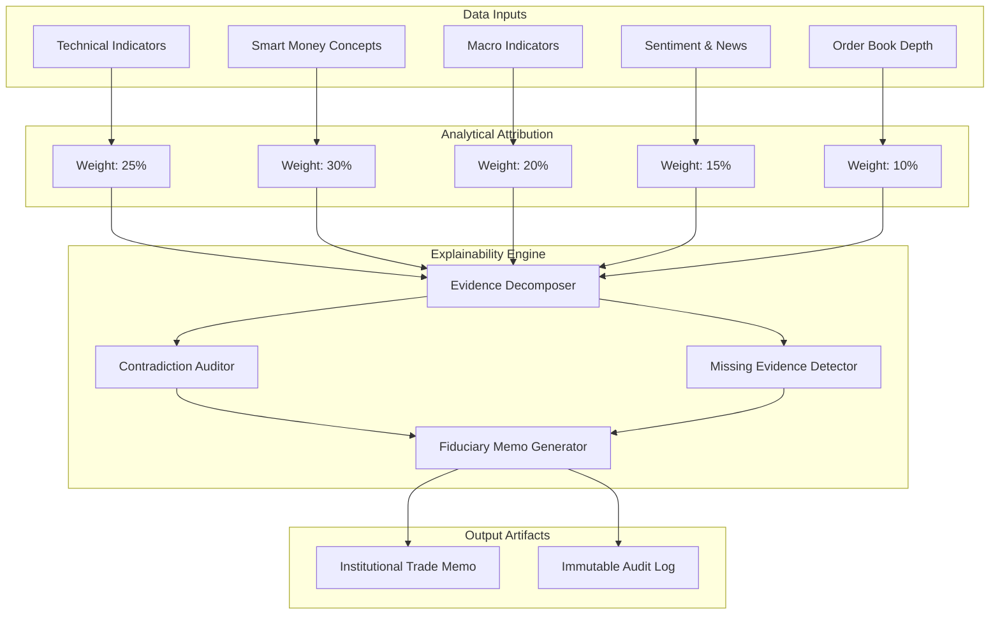

# Explainability Engine Specification

Version: 1.0.0  
Status: Architectural Blueprint (Phase 2)  
Audience: Quantitative Researchers, Compliance Officers, Institutional Risk Managers  

---

## 1. Executive Summary & Fiduciary Requirement

In institutional trading, "black-box" decisions—whether from complex quantitative models or deep neural networks—are strictly unacceptable. Capital allocators, risk committees, and regulators require full auditability and explainability:
- **Why Long?** What specific market conditions, structural breaks, and statistical probabilities justify deploying long capital?
- **Why Short?** What institutional distribution or macro headwind dictates short exposure?
- **Why Hold?** What conflicting signals or risk constraints dictate waiting on the sidelines?

The **Explainability Engine** decomposes every decision produced by the multi-agent AI pipeline into measurable, auditable contributions:
1. **Evidence Weighting Decomposition**: Attribution of each analytical module (Technical, Macro, Smart Money, Sentiment, On-Chain).
2. **Probability & Confidence Contributions**: Mathematical breakdown of how Bayesian priors and Gemini likelihood adjustments formed the final conviction score.
3. **Contradictory Evidence Auditing**: Explicitly surfacing dissenting arguments (e.g. Bull thesis supported by RSI divergence, but negated by bearish Macro FED stance).
4. **Missing Evidence Detection**: Flagging absent data streams (e.g. illiquid order book, unconfirmed on-chain volume) and adjusting position sizing downward accordingly.
5. **Human-Readable Fiduciary Memo**: Auto-generation of a structured, professional investment committee memorandum.

---

## 2. Decision Decomposition Architecture



---

## 3. Data Contracts & Data Transfer Objects

```python
from dataclasses import dataclass, field
from datetime import datetime, timezone
from decimal import Decimal
from enum import Enum
from typing import Any, Dict, List, Optional, Protocol, runtime_checkable


class RecommendationAction(Enum):
    LONG = "LONG"
    SHORT = "SHORT"
    HOLD = "HOLD"


@dataclass(frozen=True)
class FactorContribution:
    """Attribution metrics for a single analytical pillar."""
    factor_name: str                     # e.g., "SMC_OrderBlock", "Macro_CPI", "RSI_Momentum"
    raw_signal: str                      # "BULLISH", "BEARISH", "NEUTRAL"
    weight_percent: Decimal              # e.g., Decimal("25.0")
    directional_score: Decimal           # -1.00 (strongly bearish) to +1.00 (strongly bullish)
    confidence: Decimal                  # 0.00 to 1.00
    description: str                     # e.g., "Bullish 4h FVG retest with high volume"


@dataclass(frozen=True)
class ContradictionItem:
    """Identifies conflicting analytical signals."""
    primary_signal_name: str
    conflicting_signal_name: str
    severity: str                        # "CRITICAL", "MODERATE", "LOW"
    explanation: str                     # e.g., "SMC shows Bullish BOS, but Daily RSI shows Bearish Divergence"
    mitigation_action: str               # e.g., "Reduced position size by 50%"


@dataclass(frozen=True)
class MissingEvidenceItem:
    """Tracks missing or stale data points."""
    data_source: str                     # e.g., "CME_Gold_Commitment_Of_Traders"
    expected_cadence: str                # e.g., "Weekly"
    impact_level: str                    # "HIGH", "MEDIUM", "LOW"
    penalty_applied: Decimal             # e.g., Decimal("0.10") deduction from confidence score


@dataclass(frozen=True)
class TradeExplainabilityReport:
    """Institutional investment committee memo explaining a single trade decision."""
    report_id: str
    decision_id: str
    symbol: str
    timestamp: datetime
    action: RecommendationAction
    final_conviction: Decimal            # 0.00 to 1.00
    probability_up: Decimal              # Bayesian P(Up)
    probability_down: Decimal            # Bayesian P(Down)
    expected_value_bps: Decimal          # Expected Return in Basis Points
    factor_contributions: Tuple[FactorContribution, ...]
    contradictions: Tuple[ContradictionItem, ...]
    missing_evidence: Tuple[MissingEvidenceItem, ...]
    executive_summary: str
    rejection_rationale: Optional[str] = None  # Populated if action == HOLD
```

---

## 4. Explainability Engine Protocol

```python
@runtime_checkable
class ExplainabilityEngine(Protocol):
    """Protocol for decomposing AI trading decisions into auditable fiduciary rationales."""

    def explain_decision(
        self,
        decision_id: str,
        symbol: str,
        action: RecommendationAction,
        factors: List[FactorContribution],
        market_context: Dict[str, Any]
    ) -> TradeExplainabilityReport:
        """Decompose signals, audit contradictions, and construct the fiduciary report."""
        ...

    def generate_fiduciary_markdown(self, report: TradeExplainabilityReport) -> str:
        """Format the report into a standard markdown memo for risk committee review."""
        ...
```

---

## 5. Standard Institutional Fiduciary Report Template

```markdown
# INSTITUTIONAL TRADE ALLOCATION MEMORANDUM
**ID:** REP-20261109-BTCUSDT-001  
**Timestamp:** 2026-11-09 14:00:00 UTC  
**Asset:** BTC/USDT (Crypto - Spot)  
**Proposed Action:** LONG  
**Conviction Score:** 84.5%  
**Mathematical Expected Value:** +142 bps (Risk/Reward: 1:2.85)  

---

### 1. Executive Thesis
The platform recommends a LONG allocation in BTCUSDT following a confirmed 4-hour Change of Character (CHoCH) above $88,200 accompanied by a bullish retest of an unfilled Fair Value Gap ($87,600 - $87,950). Macro indicators confirm non-farm payroll stabilization, while funding rates remain neutral (0.0041%), indicating no retail overleveraging.

### 2. Evidence Weighting & Factor Attribution
| Factor | Weight | Signal | Directional Impact | Confidence | Summary |
| :--- | :--- | :--- | :--- | :--- | :--- |
| **SMC Market Structure** | 30% | BULLISH | +0.90 | 95% | 4h CHoCH + Unmitigated FVG defense |
| **Technical Momentum** | 25% | BULLISH | +0.70 | 85% | RSI (58.2), Price > 50 EMA & 200 EMA |
| **Macro Environment** | 20% | BULLISH | +0.60 | 80% | DXY softening (-0.35%), Yields flat |
| **Sentiment & News** | 15% | NEUTRAL | +0.10 | 70% | Sentiment score +0.18; low social hype |
| **Order Book & Liquidity**| 10% | BULLISH | +0.80 | 90% | Strong bid wall at $87,500; low ask resistance |

### 3. Contradictory Evidence Audit
- **Warning**: 1-hour Bollinger Band indicates local exhaustion (upper band touch).
- **Mitigation**: Stagger entry across 3 limit tranches instead of an aggressive market sweep.

### 4. Missing Evidence & Penalties
- **Missing**: Glassnode On-Chain Miner Outflow (Stale by > 4 hours).
- **Penalty Applied**: -5.0% confidence deduction reflected in position sizing.

### 5. Risk & Invalidation Boundaries
- **Target Entry Zone:** $87,700 - $87,900
- **Structural Invalidation (Stop Loss):** $87,150 (below FVG low; max risk 0.85% capital)
- **Primary Take Profit:** $89,950 (Session VAH + previous liquidity pool)
```
