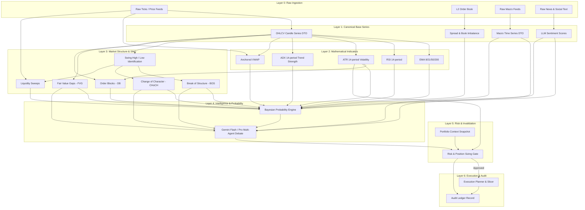

# Feature Dependency Graph Specification

Version: 1.0.0  
Status: Architectural Blueprint (Phase 2)  
Audience: Quantitative Architects, Feature Pipeline Engineers  

---

## 1. Executive Summary & Graph Philosophy

In quantitative and AI-driven trading systems, derived features and signals exhibit hierarchical dependencies. For example:
- Exponential Moving Averages (`EMA`) cannot be computed without verified `OHLCV` series.
- Smart Money Break of Structure (`BOS`) cannot be identified without valid swing highs/lows computed from `OHLCV`.
- Fair Value Gaps (`FVG`) require sequential 3-candle price evaluations.
- Statistical probability estimation (`ProbabilityEngine`) requires indicators and structural features.
- Final risk validation (`RiskManager`) requires both probability estimates and portfolio exposure context.

If dependencies are allowed to reference one another arbitrarily, circular references, deadlocks, and stale state bugs emerge. The platform enforces a strict **Directed Acyclic Graph (DAG)** with mathematically proven acyclicity.

---

## 2. Global Dependency DAG (Mermaid)

---

## 3. Layer Separation & Strict Invariants

To guarantee acyclicity:
1. **Unidirectional Flow**: Nodes in Layer $N$ may **only consume inputs from Layer $k < N$**.
2. **No Intralayer Circularity**: Nodes within Layer $N$ cannot have mutual dependencies.
3. **No Upward Feedback in Single-Pass Computation**: An execution outcome or risk rejection cannot alter past historical indicator calculations for the current bar.
4. **Mathematical Acyclicity Proof**:
   Let $G = (V, E)$ be the dependency graph where $V$ is partitioned into sets $L_0, L_1, \dots, L_6$.  
   For every directed edge $(u, v) \in E$, if $u \in L_i$ and $v \in L_j$, then $i < j$.  
   Since the order relation $<$ on integers is strictly well-ordered and irreflexive, there cannot exist a cycle $v_1 \to v_2 \to \dots \to v_k \to v_1$. Hence, $G$ is strictly acyclic.

---

## 4. Topological Sort Order

When a new candle closes for symbol $S$, the execution pipeline processes the DAG in the following topological order:

1. `OHLCVSeriesDTO` finalized for bar $T$.
2. Parallel calculation of basic indicators:
   - `EMA(9, 21, 50, 200)`
   - `RSI(14)`
   - `ATR(14)`
   - `ADX(14)`
   - `VWAP`
3. Structural evaluation:
   - Identify Swing Highs and Swing Lows.
   - Detect `BOS` and `CHoCH`.
   - Calculate `FairValueGapRecord` and `OrderBlockRecord`.
4. Feature Store aggregation into `MarketStructureSnapshot`.
5. `ProbabilityEngine`:
   - Compute Prior probabilities via historical transition matrices.
   - Update Posterior $P(Up), P(Down), P(Flat)$ using Bayesian evidence weighting.
   - Calculate Shannon Entropy $H(X)$.
6. `Gemini Agent Dialectical Debate`:
   - Technical Analyst + Smart Money Analyst evaluate structural signals.
   - News/Macro Analyst evaluates exogenous catalysts.
   - Bull vs Bear debate synthesis.
7. `RiskManager`:
   - Consult `PortfolioContext`.
   - Check daily drawdown and concentration caps.
   - Calculate position size based on $1.5 \times ATR$ stop loss.
8. `ExecutionPlanner`:
   - Generate child order slices if risk approval is granted.
9. `AuditTrail`:
   - Commit SHA-256 sealed audit record.
