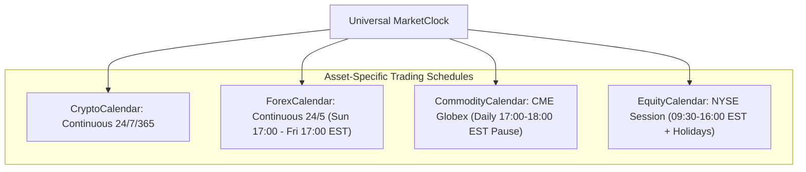

# Market Clock & Multi-Asset Trading Calendar Specification

*Document Version: 1.0.0 | Status: Architectural Design | Scope: Session Scheduling & Point-in-Time Awareness*

---

## 1. Architectural Mandate

Different global asset classes operate under fundamentally divergent temporal regimes:
- **Cryptocurrency (BTC)**: Trades 24 hours a day, 7 days a week, 365 days a year without session breaks or exchange holidays.
- **Foreign Exchange (USDJPY, EURUSD, GBPUSD)**: Trades 24 hours a day, 5 days a week. Opens Sunday at 17:00 EST (22:00 UTC) with Wellington/Sydney and closes Friday at 17:00 EST (22:00 UTC) with New York.
- **Precious Metals & Commodities (XAUUSD / COMEX Gold)**: Operates on CME Globex trading hours: Sunday 18:00 EST to Friday 17:00 EST, with a mandatory daily 60-minute settlement maintenance pause between 17:00 and 18:00 EST.
- **Equities (U.S. Stocks & Indices)**: Standard NYSE/NASDAQ session (09:30 to 16:00 EST), flanked by pre-market (04:00 to 09:30 EST) and post-market (16:00 to 20:00 EST), observing federal exchange holidays.



---

## 2. Institutional Trading Sessions & Overlaps

For currencies and spot metals, liquidity, spread compression, and volatility are concentrated within specific regional interbank trading sessions and their overlaps:

| Session Name | Regional Centers | Operating Hours (UTC) | Volatility Profile & Institutional Focus |
| :--- | :--- | :--- | :--- |
| **Asian Session** | Tokyo, Hong Kong, Singapore, Sydney | 00:00 – 09:00 UTC | High USDJPY price discovery, BOJ rate announcements, lower Gold volatility. |
| **European / London Session** | London, Frankfurt, Zurich | 08:00 – 16:30 UTC | Major global FX and Gold fixing (LBMA AM/PM fixes at 10:30 and 15:00 UTC). |
| **New York Session** | New York, Chicago | 13:00 – 22:00 UTC | High liquidity, U.S. economic data releases (CPI, NFP at 12:30/13:30 UTC), FOMC decisions. |
| **London/NY Overlap** | London + New York | **13:00 – 16:30 UTC** | **Peak Global Liquidity Window**: Tightest spreads and highest institutional order book depth for XAUUSD and FX. |
| **Daily CME Pause** | Chicago / New York | 22:00 – 23:00 UTC (17:00-18:00 EST) | Gold futures and FX interbank rollover. Spread widening; no execution allowed. |

---

## 3. `MarketClock` Interface Contract

```python
"""Universal MarketClock contract for multi-asset scheduling (Design Contract)."""

from datetime import date, datetime
from enum import Enum
from typing import Protocol, runtime_checkable
from tradingagents.dataflows.contracts.symbol import CanonicalSymbol


class SessionType(str, Enum):
    """Trading session classifications."""
    CLOSED = "closed"
    ASIAN = "asian"
    EUROPEAN = "european"
    US_REGULAR = "us_regular"
    US_PRE_MARKET = "us_pre_market"
    US_POST_MARKET = "us_post_market"
    LONDON_NY_OVERLAP = "london_ny_overlap"
    DAILY_MAINTENANCE = "daily_maintenance"
    WEEKEND = "weekend"


@runtime_checkable
class MarketClock(Protocol):
    """Universal calendar and session scheduler for multi-asset trading."""

    def is_market_open(
        self, asset: CanonicalSymbol, at_time: datetime | None = None
    ) -> bool:
        """Return True if the asset is currently in an active, tradable market session."""
        ...

    def next_open(
        self, asset: CanonicalSymbol, at_time: datetime | None = None
    ) -> datetime:
        """Return the next market opening UTC datetime if currently closed or in break."""
        ...

    def next_close(
        self, asset: CanonicalSymbol, at_time: datetime | None = None
    ) -> datetime:
        """Return the scheduled market close or daily settlement pause UTC datetime."""
        ...

    def current_session(
        self, asset: CanonicalSymbol, at_time: datetime | None = None
    ) -> SessionType:
        """Identify the active regional trading session or overlap regime."""
        ...

    def trading_day(
        self, asset: CanonicalSymbol, at_time: datetime | None = None
    ) -> date:
        """Return the current formal exchange accounting trading day."""
        ...

    def trading_week(
        self, asset: CanonicalSymbol, at_time: datetime | None = None
    ) -> int:
        """Return ISO trading week number."""
        ...
```

---

## 4. Architectural Integration

1. **Pre-Trade Execution Gating**:
   Before formulating a trade recommendation, the Risk and Decision Engines query `MarketClock.is_market_open(symbol)`. If the market is closed or in daily maintenance (e.g., CME 17:00-18:00 EST), trades are restricted or marked for scheduled session-open execution to avoid execution at wide illiquid off-hours spreads.
2. **Backtesting & Time-Travel Prevention**:
   The backtesting engine injects a simulated `Clock` conforming to `MarketClock`, ensuring synthetic ticks and historical backtests step strictly forward through valid trading hours without lookahead leaks.
