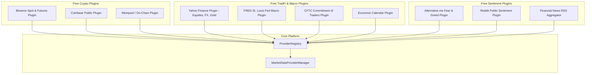

# Plugin Architecture Specification

Version: 1.0.0  
Status: Architectural Blueprint (Phase 2)  
Audience: Third-Party Integrators, Data Engineers, System Architects  

---

## 1. Executive Summary & Design Goals

To scale across multiple asset classes (Crypto, Forex, Equities, Commodities, Macro, Sentiment) without creating a monolithic, brittle codebase, the platform adopts an **Extensible Plugin Architecture**.

### Key Design Goals
1. **Zero Core Modifications**: Adding a new exchange or alternative data feed requires zero edits to the core decision engine, risk gates, or existing providers.
2. **Explicit Lifecycle Management**: Every plugin implements standard lifecycle hooks (`initialize`, `start`, `health_check`, `stop`).
3. **Strict Capability Advertising**: Plugins declare their supported asset classes, features (e.g. `funding_rate`, `orderbook`), and rate limits.
4. **Sandboxed Output**: Plugins must never contain trading strategy logic or direct broker order routing; their sole responsibility is fetching, validating, and normalizing external raw data into platform standard DTOs.
5. **Zero-Cost Mandate**: All built-in plugins interface exclusively with free, non-authenticated public endpoints or free-tier community APIs.

---

## 2. Supported Plugin Ecosystem



---

## 3. Plugin Lifecycle & Contracts

```python
from dataclasses import dataclass, field
from enum import Enum
from typing import Any, Dict, List, Optional, Protocol, Set, runtime_checkable
from datetime import datetime


class PluginState(Enum):
    UNLOADED = "UNLOADED"
    INITIALIZED = "INITIALIZED"
    RUNNING = "RUNNING"
    DEGRADED = "DEGRADED"
    STOPPED = "STOPPED"
    ERROR = "ERROR"


@dataclass(frozen=True)
class PluginManifest:
    """Metadata declaring plugin capabilities, authorship, and constraints."""
    plugin_id: str                      # e.g., "provider.crypto.binance"
    name: str                           # e.g., "Binance Public Provider"
    version: str                        # SemVer "1.0.0"
    author: str                         # e.g., "TradingAgents Core"
    asset_classes: Set[str]             # {"CRYPTO"}
    supported_features: Set[str]        # {"quotes", "ohlcv", "funding_rate", "orderbook"}
    rate_limit_rpm: int = 1200
    is_free_tier: bool = True
    requires_api_key: bool = False


@runtime_checkable
class PlatformPlugin(Protocol):
    """Protocol that all data provider and service plugins must implement."""

    @property
    def manifest(self) -> PluginManifest:
        """Return immutable plugin manifest."""
        ...

    @property
    def state(self) -> PluginState:
        """Current lifecycle state."""
        ...

    def initialize(self, config: Dict[str, Any], transport: Any) -> None:
        """Initialize plugin resources, bind transport, and validate configuration."""
        ...

    def start(self) -> None:
        """Transition plugin to RUNNING state and initiate keepalives / background threads."""
        ...

    def health_check(self) -> Dict[str, Any]:
        """Perform self-test against vendor ping endpoint; return latency and status."""
        ...

    def stop(self) -> None:
        """Gracefully release sockets, flush buffers, and transition to STOPPED state."""
        ...
```

---

## 4. Discovery & Auto-Registration Engine

The platform supports two complementary discovery mechanisms:
1. **Explicit Registry Declarations**: Configuration in `providers.yaml` specifies active plugins by package path (e.g. `tradingagents.plugins.binance.BinanceProvider`).
2. **Directory Scanning / Entrypoint Discovery**: The registry scans the `tradingagents/plugins/` directory at startup, checks plugin manifests, and auto-registers healthy plugins.

```python
@runtime_checkable
class PluginDiscoveryEngine(Protocol):
    """Protocol for scanning and loading plugins dynamically."""

    def discover_plugins(self, search_path: str) -> List[PluginManifest]:
        """Scan directory and parse manifests without executing full imports."""
        ...

    def load_plugin(self, plugin_id: str) -> PlatformPlugin:
        """Instantiate and initialize the requested plugin with dependency injection."""
        ...
```

---

## 5. Built-in Free Plugin Implementations (Roadmap)

| Plugin ID | Domain | Free Source / Protocol | Capabilities Provided |
| :--- | :--- | :--- | :--- |
| `provider.crypto.binance` | Crypto | Public REST (`api.binance.com`, `fapi.binance.com`) | Realtime Quotes, OHLCV, OrderBook, Funding Rates |
| `provider.crypto.coinbase` | Crypto | Public REST (`api.exchange.coinbase.com`) | Realtime Quotes, OHLCV, OrderBook |
| `provider.tradfi.yahoo` | Multi-Asset | Public REST (`query1.finance.yahoo.com`) | FX (USDJPY, EURUSD), Gold (GC=F), Stocks (SPY, AAPL) |
| `provider.macro.fred` | Macro | St. Louis Fed Public API | CPI, Fed Funds Rate, Non-Farm Payrolls, Treasury Yields |
| `provider.macro.cftc` | Macro | CFTC Public Socrata API | Commitments of Traders (COT) Institutional Positioning |
| `provider.onchain.mempool` | On-Chain | Mempool.space Public API | Bitcoin mempool congestion, median fee rates, difficulty |
| `provider.sentiment.fng` | Sentiment | Alternative.me Public API | Crypto Fear & Greed Index (0-100) |
| `provider.sentiment.reddit`| Sentiment | Reddit Public RSS / JSON | Subreddit sentiment scoring (`r/bitcoin`, `r/wallstreetbets`)|
