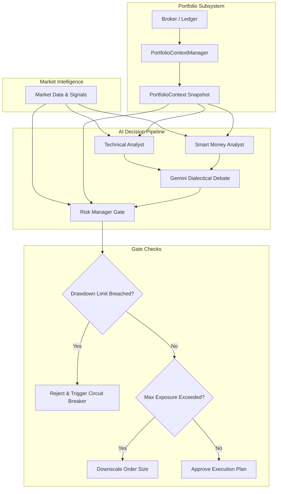

# Portfolio Context Specification

Version: 1.0.0  
Status: Architectural Blueprint (Phase 2)  
Audience: Portfolio Managers, Risk Engineers, AI Decision Architects  

---

## 1. Executive Summary

Trading decisions must never be evaluated in an isolated vacuum. An AI agent might generate a strong "BUY" signal for Gold (XAUUSD), but if the portfolio is already at 95% gross exposure, or if existing USD-denominated longs already consume 40% of risk budget, approving the trade would violate institutional risk limits and invite catastrophic margin liquidation.

The **Portfolio Context** provides a real-time, consolidated state of all holdings, cash, unrealized PnL, factor exposures, and risk budgets. Every AI agent and risk gate consumes `PortfolioContext` before generating or approving trade proposals.

---

## 2. Core Entities & Data Contracts

```python
from dataclasses import dataclass, field
from datetime import datetime, timezone
from decimal import Decimal
from enum import Enum
from typing import Dict, List, Optional, Protocol, Tuple, runtime_checkable


class PositionSide(Enum):
    LONG = "LONG"
    SHORT = "SHORT"


@dataclass(frozen=True)
class Position:
    """Represents an open active position."""
    position_id: str
    symbol: str
    asset_class: str                    # "CRYPTO", "FOREX", "COMMODITY", "EQUITY"
    side: PositionSide
    quantity: Decimal
    entry_price: Decimal
    current_price: Decimal
    unrealized_pnl: Decimal
    realized_pnl: Decimal
    notional_value_usd: Decimal
    stop_loss_price: Optional[Decimal]
    take_profit_price: Optional[Decimal]
    opened_at: datetime
    leverage: Decimal = Decimal("1.0")


@dataclass(frozen=True)
class CurrencyExposure:
    """Gross and net exposure breakdown by fiat / quote currency."""
    currency: str                       # e.g., "USD", "EUR", "JPY", "USDT"
    net_exposure_usd: Decimal
    percentage_of_nav: Decimal


@dataclass(frozen=True)
class SectorExposure:
    """Exposure breakdown by asset class or industry sector."""
    sector_name: str                    # e.g., "Precious Metals", "Layer 1 Crypto", "G10 FX"
    notional_usd: Decimal
    percentage_of_nav: Decimal


@dataclass(frozen=True)
class PortfolioContext:
    """Immutable snapshot of the total portfolio state passed into the AI Decision Pipeline."""
    account_id: str
    as_of: datetime
    total_nav_usd: Decimal              # Net Asset Value
    cash_balance_usd: Decimal
    margin_used_usd: Decimal
    margin_free_usd: Decimal
    margin_utilization_pct: Decimal     # margin_used / (margin_used + margin_free)
    
    # Position Inventory
    open_positions: Tuple[Position, ...]
    
    # Aggregated Exposures
    gross_exposure_usd: Decimal         # Sum of absolute notional values
    net_exposure_usd: Decimal           # Sum of signed notional values (Long - Short)
    gross_leverage: Decimal             # gross_exposure / NAV
    
    # Risk Limits & Drawdown
    daily_starting_nav_usd: Decimal
    current_daily_pnl_usd: Decimal
    current_daily_drawdown_pct: Decimal
    max_daily_drawdown_limit_pct: Decimal = Decimal("0.02")  # 2.0% daily hard stop
    max_portfolio_risk_bps: Decimal = Decimal("100")          # 100 bps (1.0% per-trade risk)
    
    # Exposure Breakdowns
    currency_exposures: Tuple[CurrencyExposure, ...] = ()
    sector_exposures: Tuple[SectorExposure, ...] = ()
    cross_asset_correlations: Dict[str, Dict[str, Decimal]] = field(default_factory=dict)

    def is_kill_switch_active(self) -> bool:
        """Returns True if daily drawdown breaches the strict threshold."""
        return self.current_daily_drawdown_pct >= self.max_daily_drawdown_limit_pct
```

---

## 3. Portfolio Context Manager Protocol

```python
@runtime_checkable
class PortfolioContextManager(Protocol):
    """Protocol for assembling and providing real-time portfolio snapshots."""

    def get_current_context(self, account_id: str) -> PortfolioContext:
        """Construct the immutable portfolio context from current account state."""
        ...

    def evaluate_order_impact(
        self,
        context: PortfolioContext,
        proposed_symbol: str,
        proposed_side: PositionSide,
        proposed_notional_usd: Decimal
    ) -> Tuple[bool, Optional[str]]:
        """
        Check if proposed order breaches:
        1. Max gross leverage
        2. Single-asset concentration limit
        3. Currency exposure limits
        4. Cross-asset correlation clustering
        """
        ...
```

---

## 4. Integration into Decision & Agent Pipeline



---

## 5. Risk Constraints & Invariants

1. **Drawdown Kill Switch**: If `current_daily_drawdown_pct >= max_daily_drawdown_limit_pct` (e.g. 2%), all agent buy/sell proposals are immediately rejected with reason `"DAILY_DRAWDOWN_BREACH"`.
2. **Single-Asset Cap**: No single asset (e.g. BTC or XAUUSD) may exceed 25% of total Net Asset Value (NAV).
3. **Currency Skew Cap**: Net unhedged exposure to any single non-USD currency (e.g. JPY, EUR, GBP) may not exceed 30% of NAV.
4. **Correlation Clustering**: If the portfolio already holds BTC long, adding a high-beta crypto long (e.g. SOL or ETH) is throttled if the cross-correlation exceeds $0.85$.
