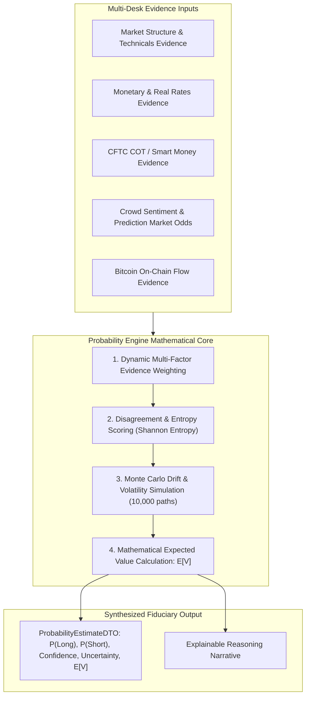

# Quantitative Probability Engine Specification

*Document Version: 1.0.0 | Status: Architectural Design | Scope: Statistical Signal Synthesis & Expected Value*

---

## 1. Architectural Mandate & Objective

The long-term objective of the platform is **not simply collecting market data**. The objective is to build an institutional AI system capable of producing **statistically grounded, risk-adjusted probability distributions, confidence bounds, and explainable fiduciary trade recommendations**.

The Probability Engine serves as the mathematical core between qualitative multi-agent analytical desks and fiduciary execution gating. It converts heterogeneous, noisy analytical evidence into a calibrated probability distribution:

$$P(\text{Long}) + P(\text{Short}) + P(\text{Neutral}) = 1.0$$



---

## 2. Core Data Contracts: `ProbabilityEstimateDTO`

```python
"""Probability Engine DTO and Contract Specification (Design Only)."""

from dataclasses import dataclass
from datetime import datetime
from decimal import Decimal
from typing import Sequence


@dataclass(frozen=True)
class SignalEvidenceDTO:
    """Individual evidence item from an analytical desk."""
    desk_name: str             # e.g., "macro_rates", "market_structure", "cftc_positioning"
    directional_bias: str      # "BULLISH", "BEARISH", "NEUTRAL"
    raw_score: Decimal         # Scaled [-1.0 to +1.0]
    assigned_weight: Decimal   # Reliability weight [0.0 to 1.0]
    confidence: Decimal        # Desk confidence [0.0 to 1.0]
    key_observation: str       # Factual justification citation


@dataclass(frozen=True)
class ConflictingSignalsDTO:
    """Analysis of cross-desk divergence and cognitive tension."""
    has_major_conflict: bool
    conflict_intensity: Decimal       # Scale [0.0 = total consensus to 1.0 = diametric opposition]
    bullish_desks: tuple[str, ...]    # Desks arguing for long
    bearish_desks: tuple[str, ...]    # Desks arguing for short
    resolution_rationale: str         # Deterministic rationale for dominant regime


@dataclass(frozen=True)
class ProbabilityEstimateDTO:
    """Final synthesized institutional probability distribution."""
    symbol: str
    timestamp: datetime
    
    # Probability distribution summing to 1.0
    long_probability: Decimal         # P(Bullish Continuation / Upside)
    short_probability: Decimal        # P(Bearish Reversal / Downside)
    neutral_probability: Decimal      # P(Ranging / Chop / Capital Preservation)
    
    # Statistical confidence and uncertainty bounds
    confidence_score: Decimal         # [0.0 = zero conviction to 1.0 = maximum conviction]
    uncertainty_score: Decimal        # Shannon entropy normalized [0.0 to 1.0]
    
    # Expected Value & Sizing metrics
    expected_value: Decimal           # E[V] per unit risked
    target_reward_risk_ratio: Decimal # R-multiple hurdle
    
    # Evidence breakdown & auditable explanation
    evidence_breakdown: tuple[SignalEvidenceDTO, ...]
    conflict_analysis: ConflictingSignalsDTO
    explanation: str                  # Auditable human-readable reasoning narrative
```

---

## 3. Mathematical Foundations

### 3.1 Multi-Factor Evidence Weighting
Each analytical desk is assigned a dynamic weight based on historical predictive validity and asset class relevance:

$$W_i = \text{BaseWeight}_i \times \text{RegimeMultiplier}_i \times \text{FreshnessScore}_i$$

For example, when analyzing **XAUUSD (Gold)**:
- Macro Real Rates & Sovereign Yields: $30\%$ base weight.
- CFTC COT Institutional Positioning: $25\%$ base weight.
- Market Structure & Volatility: $20\%$ base weight.
- Technical Trend: $15\%$ base weight.
- Retail Sentiment: $10\%$ base weight (contrarian filter).

### 3.2 Conflicting Signal Handling & Entropy Scoring
When desks emit contradictory signals (e.g. Technicals are Bullish while Macro & Rates are Bearish), the engine computes normalized Shannon Entropy:

$$H(P) = -\sum_{i \in \{\text{long, short, neutral}\}} P_i \log_2(P_i)$$

$$\text{Uncertainty Score} = \frac{H(P)}{\log_2(3)}$$

- **Low Uncertainty ($< 0.40$)**: High inter-desk consensus. Confidence score remains high ($> 80\%$).
- **High Uncertainty ($> 0.75$)**: Severe cognitive tension between fundamental and technical drivers. The engine automatically expands `neutral_probability`, compresses position sizing, and triggers an explicit risk warning.

### 3.3 Expected Value ($\mathbb{E}[V]$) Gating
The decision engine enforces a mathematical hurdle before any trade is recommended:

$$\mathbb{E}[V] = (P_{\text{long}} \times R_{\text{win}}) - (P_{\text{short}} \times 1.0) - \text{Friction}_{\text{spread+fees}}$$

**Inviolable Gating Rule**: If $\mathbb{E}[V] \le 0.0$, the platform automatically vetoes trade execution and outputs an immutable `HOLD` recommendation.
