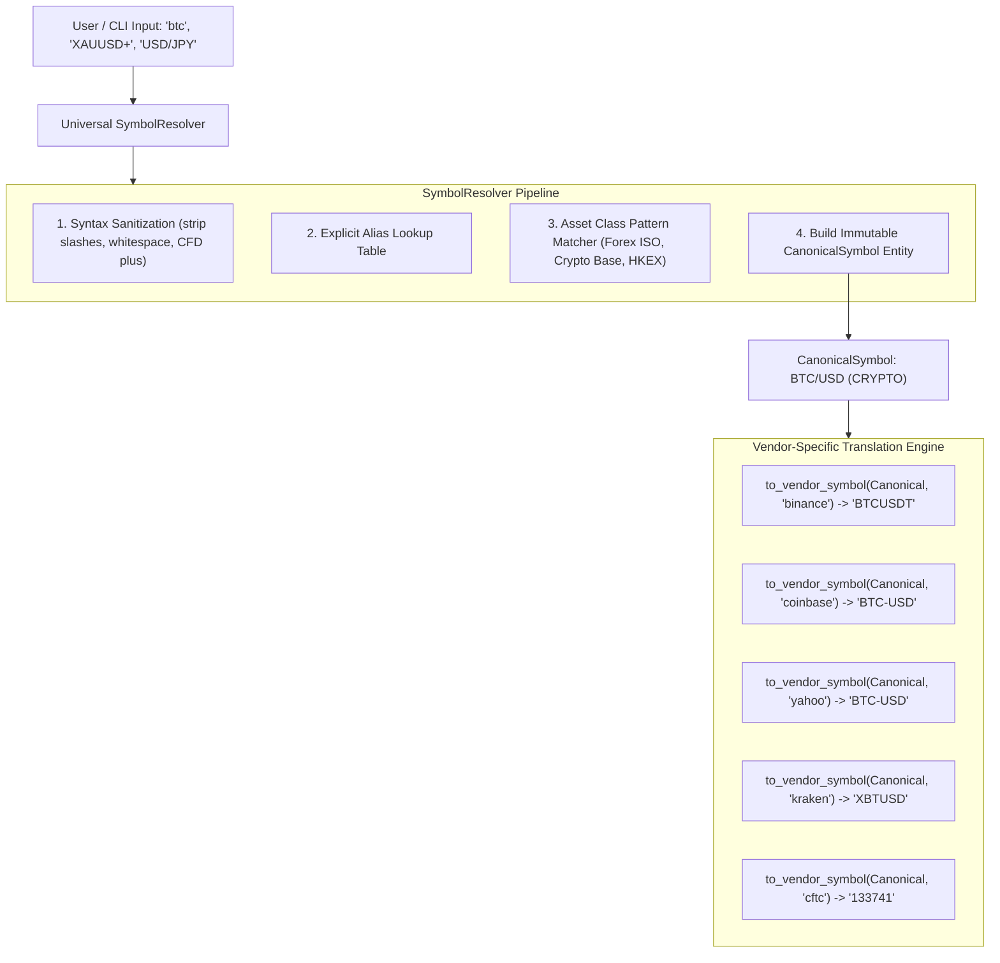

# Universal Symbol Resolver Specification

*Document Version: 1.0.0 | Status: Architectural Design | Scope: Cross-Asset Identity & Mapping*

---

## 1. Architectural Mandate & Invariants

In an institutional multi-asset platform, data vendors, exchanges, brokers, and regulatory bodies use divergent symbology for identical underlying financial instruments:

| User Input / Alias | Canonical Identity | Binance Symbol | Coinbase Symbol | Yahoo Finance Symbol | Kraken Symbol | CFTC Contract Code |
| :--- | :--- | :--- | :--- | :--- | :--- | :--- |
| `BTC`, `XBT`, `BTCUSD`, `BTCUSDT` | **`BTC/USD`** (Crypto) | `BTCUSDT` | `BTC-USD` | `BTC-USD` | `XBTUSD` | `133741` (CME) |
| `XAUUSD`, `GOLD`, `XAU` | **`XAU/USD`** (Commodity) | N/A | N/A | `GC=F` (COMEX) | `PAXGUSD` (Proxy) | `088691` (COMEX Gold) |
| `USDJPY`, `USD/JPY`, `USD-JPY` | **`USD/JPY`** (Forex) | N/A | N/A | `USDJPY=X` | N/A | `097741` (CME JPY) |
| `EURUSD`, `EUR/USD` | **`EUR/USD`** (Forex) | N/A | N/A | `EURUSD=X` | N/A | `099741` (CME EUR) |
| `GBPUSD`, `GBP/USD` | **`GBP/USD`** (Forex) | N/A | N/A | `GBPUSD=X` | N/A | `096742` (CME GBP) |
| `SP500`, `SPX500`, `US500` | **`SPX`** (Index) | N/A | N/A | `^GSPC` | N/A | `13874+` (CME E-mini) |
| `AAPL` | **`AAPL`** (Stock) | N/A | N/A | `AAPL` | N/A | N/A |

### Permanent Invariant:
**No provider adapter may ever perform symbol conversion or alias resolution internally.** Providers are strictly isolated data ingestion pipelines. A provider receives only its vendor-specific symbol (or queries the `SymbolResolver` via injected interface). The application core operates exclusively on **Canonical Asset Identities**.

---

## 2. Canonical Asset Model

```python
"""Architectural Contract for Universal Symbol Representation (Design Only)."""

from dataclasses import dataclass
from enum import Enum


class AssetClass(str, Enum):
    """Primary institutional asset classes."""
    CRYPTO = "crypto"
    COMMODITY = "commodity"
    FOREX = "forex"
    STOCK = "stock"
    INDEX = "index"


@dataclass(frozen=True)
class CanonicalSymbol:
    """Universal internal representation of a financial instrument."""
    canonical_id: str          # e.g., "BTC/USD", "XAU/USD", "USD/JPY", "AAPL"
    asset_class: AssetClass    # AssetClass.CRYPTO, COMMODITY, FOREX, STOCK, INDEX
    base_asset: str            # e.g., "BTC", "XAU", "USD", "AAPL"
    quote_currency: str        # e.g., "USD", "JPY", "EUR"
    display_name: str          # e.g., "Bitcoin / US Dollar", "Spot Gold (Troy Ounce)"
    settlement_currency: str   # e.g., "USD", "USDT"
    price_precision: int       # e.g., 2 for stocks, 4 for FX, 2 for BTC
    quantity_precision: int    # e.g., 8 for BTC, 0 for stocks
```

---

## 3. Universal SymbolResolver Architecture



### 3.1 Normalization Strategy
1. **Sanitization**: Remove whitespace, uppercase characters, strip broker CFD qualifiers (`+`), and remove formatting slashes (`/`, `-`).
2. **Deterministic Classification**:
   - Bare six-letter ISO pairs (`USDJPY`, `EURUSD`, `GBPUSD`) where both halves are ISO-4217 currencies $\rightarrow$ `AssetClass.FOREX`.
   - Known cryptocurrency bases (`BTC`, `XBT`, `ETH`, `SOL`) or pairs ending in crypto quotes (`USDT`, `USDC`, `USD`) $\rightarrow$ `AssetClass.CRYPTO`.
   - Precious metals (`XAU`, `XAUUSD`, `GOLD`, `XAG`, `SILVER`) $\rightarrow$ `AssetClass.COMMODITY`.
   - Numeric exchange suffixes (`0700.HK`, `600519.SH`) or standard equity tickers (`AAPL`, `MSFT`) $\rightarrow$ `AssetClass.STOCK`.
   - Caret or known index names (`^GSPC`, `SPX500`, `NAS100`) $\rightarrow$ `AssetClass.INDEX`.
3. **Vendor Symbol Resolution**:
   The `SymbolResolver` maintains bidirectional mapping tables indexed by `(CanonicalSymbol, VendorName)`:
   ```python
   class SymbolResolver(Protocol):
       def resolve(self, raw_input: str) -> CanonicalSymbol: ...
       def to_vendor_symbol(self, canonical: CanonicalSymbol, vendor_name: str) -> str: ...
       def from_vendor_symbol(self, vendor_symbol: str, vendor_name: str) -> CanonicalSymbol: ...
       def supports_asset_class(self, canonical: CanonicalSymbol, vendor_name: str) -> bool: ...
   ```

---

## 4. Backward Compatibility & Extensibility

- **Legacy Compatibility**: `normalize_symbol(raw)` in [tradingagents/dataflows/symbols.py](file:///Users/balgurimukeshrao/Documents/TradingAgents-main/tradingagents/dataflows/symbols.py) remains the public entry point for existing equity tools and delegates directly to `SymbolResolver.to_vendor_symbol(resolved, "yahoo")`.
- **Zero Provider Coupling**: Concrete providers never embed `if symbol == "BTC": return "BTCUSDT"`. Instead, `MarketDataProviderManager` maps the canonical symbol using `SymbolResolver` before dispatching to the target provider.
