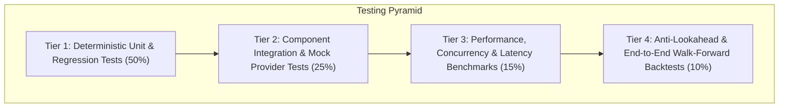
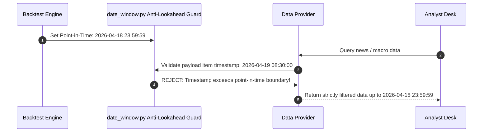

# Testing & Quality Assurance Strategy

*Document Version: 1.0.0 | Status: Active Quality Standard | Scope: Entire Test Pipeline*

---

## 1. Testing Philosophy & Quality Pyramid

In an institutional trading intelligence system, analytical reliability, quantitative determinism, and data integrity are non-negotiable. Software errors directly translate to flawed risk assessments and capital loss.

The platform follows a rigorous testing pyramid designed for **100% offline determinism**:



---

## 2. Test Classification & Methodologies

### 2.1 Unit Tests
- **Scope**: Individual mathematical functions, string sanitizers, symbol normalizers, and DTO validators.
- **Location**: `tests/test_*.py`
- **Execution Speed**: $< 5$ milliseconds per test.
- **Rules**:
  - Pure in-memory execution; no network calls, no disk writes outside `/tmp`.
  - Must test standard paths, boundary conditions, edge cases, and explicit error states.
  - Examples: `test_symbols.py`, `test_multiasset_symbols.py`, `test_safe_ticker_component.py`.

### 2.2 Integration Tests
- **Scope**: Interaction between multiple modules (e.g. Data Router dispatching to Vendor Adapters, State Propagator constructing graph states, Analyst Desks parsing DTOs).
- **Mocking**: External endpoints are intercepted via static JSON fixtures or mock transport clients.
- **Key Assertions**:
  - Serialization and deserialization contracts between layers.
  - Failover behavior (e.g. Binance HTTP 500 automatically falling back to Coinbase public REST).
  - Proper raising and handling of domain exceptions (`NoMarketDataError`, `VendorUnavailableError`).

### 2.3 Regression Tests
- **Scope**: Guaranteeing that newly introduced asset classes and features do not alter existing behavior.
- **Mandate**:
  - Legacy equity tickers (`AAPL`, `MSFT`, `BRK.B`) and international codes (`0700.HK`, `600519.SH`) must resolve identically.
  - Existing prompt structures and graph transitions must not break existing report outputs.
  - Regression test suite must pass 100% before any commit or PR approval.

### 2.4 Performance & Latency Tests
- **Scope**: Ensuring system operates within strict institutional latency and memory limits.
- **Benchmarks**:
  - **Symbol Normalization**: $< 0.1$ ms per resolution.
  - **Data Ingestion & Parsing**: $< 50$ ms from cached payload to typed DTO.
  - **Network Timeout Boundary**: External HTTP adapters must terminate within 10.0 seconds under simulated packet blackholes.
  - **Memory Footprint**: Memory growth per analytical run must not leak across sequential runs.

---

## 3. Mock Provider Framework & Offline Testing

Automated testing must never depend on live third-party network APIs. Live external network calls create flaky tests due to rate limiting, server downtime, and changing market prices.

### 3.1 Mock Provider Architecture

```python
"""Example Mock Provider Pattern for Offline Testing (Contract)."""

from datetime import datetime
from tradingagents.dataflows.interface import (
    MarketDataProvider, QuoteDTO, OHLCVSeriesDTO, Timeframe, HealthStatusDTO, HealthState
)

class MockBinanceProvider(MarketDataProvider):
    """Deterministic, zero-network mock provider for crypto tests."""

    @property
    def provider_name(self) -> str:
        return "mock_binance"

    def health_check(self) -> HealthStatusDTO:
        return HealthStatusDTO(
            provider_name=self.provider_name,
            state=HealthState.HEALTHY,
            latency_ms=1.2,
            last_successful_query=datetime.now(),
        )

    def get_quote(self, symbol: str, as_of: datetime | None = None) -> QuoteDTO:
        return QuoteDTO(
            symbol=symbol,
            price=65000.0,
            bid=64995.0,
            ask=65005.0,
            bid_size=2.5,
            ask_size=3.1,
            volume_24h=1500000000.0,
            timestamp=datetime(2026, 4, 18, 12, 0, 0),
        )
```

### 3.2 Recorded JSON Fixture Repository
- Static test fixtures reside in `tests/fixtures/`:
  - `fixtures/binance_btc_klines_1h.json`
  - `fixtures/coinbase_btc_candles.json`
  - `fixtures/binance_btc_depth_l2.json`
  - `fixtures/binance_btc_funding_rate.json`
  - `fixtures/cftc_cot_gold_sample.txt`
  - `fixtures/fred_dgs10_sample.json`
- Tests load fixtures directly, ensuring 100% repeatable assertions across all machines and CI environments.

---

## 4. Anti-Lookahead Validation Protocol

Lookahead bias is the catastrophic flaw of financial intelligence systems: if an agent makes a decision on `2026-04-18` using news, prices, or economic reports published on `2026-04-19`, the resulting strategy will look extraordinarily profitable in backtesting but fail completely in live capital deployment.

### Lookahead Guardrail Invariants:



1. **Strict Timestamp Filtering**: Every data provider method accepting `as_of` must filter out any candle, article, or indicator revision dated $> \text{as\_of}$.
2. **Economic Release Lag**: Macroeconomic data (e.g. CPI, Non-Farm Payrolls) must use the **Release Date**, not the **Reference Period Date** (e.g., March CPI released in mid-April must not be visible to an analysis run in late March).
3. **Automated Lookahead Unit Tests**: Dedicated tests deliberately attempt to query future timestamps to verify that the pipeline throws an explicit error or filters them out.

---

## 5. Test Execution Protocols

### Standard Local Test Execution:
```bash
# Run all unit and regression tests
python3 -m unittest discover -s tests -p "test_*.py"

# Run specific multi-asset symbol suite
python3 -m unittest tests/test_multiasset_symbols.py

# Run path traversal security tests
python3 -m unittest tests/test_safe_ticker_component.py
```

### Pull Request & CI/CD Gating Rules:
1. **Zero Test Failures**: 100% pass rate required. A single failure halts merging.
2. **Regression Suite Mandatory**: Any PR that breaks existing tests in `tests/test_symbols.py` is immediately rejected.
3. **Execution Time**: The complete unit test suite must finish in $< 10$ seconds on standard developer machines.
